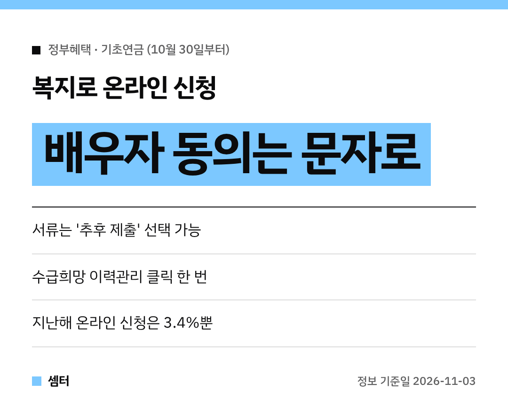

기초연금 온라인 신청, 배우자 동의에서 막혀서 결국 포기하신 분들 계시죠~?
**10월 30일부터** 복지로 신청 절차가 확 쉬워졌어요 😊

## 왜 바뀌었어요?
기초연금은 본인과 배우자의 소득·재산을 함께 보기 때문에 **부부 모두 금융정보 제공 동의**가 필요해요.
그런데 이게 번거로워서 지난해 신청자 88만 7431명 중 온라인 신청은 **3.4%**뿐이었대요.

온라인 신청을 중간에 그만둔 이유도 동의 문제(37.2%)와 서류 작성(38%)이 대부분이었어요.

## 바뀐 점 ① 배우자 동의는 문자로
전엔 서류를 내거나 부부가 같은 시간·같은 자리에 있어야 했어요.
이제는 배우자에게 **동의할 수 있는 주소가 문자로** 가고, 배우자가 편할 때 바로 누르면 돼요 👍

## 바뀐 점 ② 서류는 나중에 내도 OK
임대차계약서처럼 공적자료로 연계 안 되는 서류는 파일을 붙여야만 신청이 끝났는데요.
이제 **'추후 제출'**을 고르면 신청부터 마칠 수 있어요.

서류는 준비되는 대로 온라인이나 방문으로 내면 된대요.

## 바뀐 점 ③ 수급희망 이력관리도 한 번에
기초연금에서 떨어져도, **5년 동안 매년 2번** 소득·재산을 다시 살펴 받을 수 있게 되면 신청한 걸로 쳐 주는 제도예요.
전엔 신청서를 따로 써야 했는데, 이제 신청 화면에서 **클릭 한 번**이면 같이 돼요.

혹시 탈락할까 걱정되시면 이건 꼭 체크해 두세요!

## 어디서 신청해요?
복지로(www.bokjiro.go.kr)에서 온라인으로 신청할 수 있어요.

다들 부모님 노후 든든하게 챙기시구! 오늘도 좋은 하루 보내세요~ㅎㅎ
