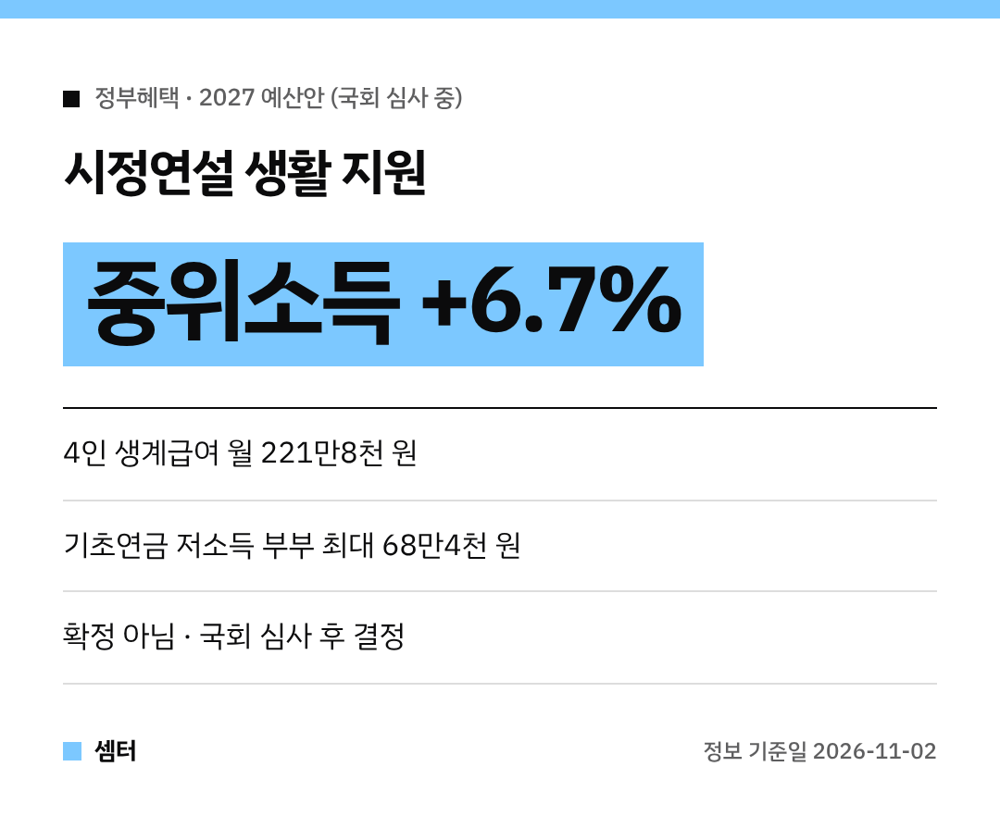

오늘(11월 2일) 국회에서 **2027년 예산안 시정연설**이 있었어요~!
내 생활에 닿는 지원만 쏙 골라서 정리해 봤어요 😊

먼저 꼭 알아 두실 점!
이건 정부가 낸 **예산안**이라서, 국회 심사를 거쳐야 확정돼요.
지금은 **확정 아님** 단계라 금액이 바뀔 수 있답니다.

## 복지 신청 방식이 바뀌어요
주요 사회보장급여를 신청주의에서 자동주의로 바꾸겠다고 했어요.
자격이 되면 따로 신청하지 않아도 지원을 받게 하겠다는 거예요.
몰라서 못 받는 일이 줄어들 수 있겠죠? 👍

## 기준 중위소득 6.7% 인상
60여 개 복지사업의 대상자를 고르는 기준인 중위소득을 6.7% 올린대요.
역대 최대 인상폭이라고 했어요!
기준선이 올라가면, 지금은 아슬아슬하게 못 받던 집도 대상이 될 수 있어요.

그래서 생계·의료·교육·주거, 기초생활보장 4대 급여가 함께 늘어나요.
**4인 가구 생계급여는 월 221만8000원**까지 오른다고 해요.

## 어르신 지원
| 항목 | 예산안 내용 |
|---|---|
| 기초연금 | 저소득 어르신 **월 최대 3만 원** 추가 |
| 저소득 부부 | 감액 비율 절반으로, 56만 원 → **최대 68만4000원** |
| 노인일자리 | **118만 개**로 확대 |

## 장애인 지원
장애인연금 대상을 **35만 명에서 61만 명**으로 넓힌대요.

## 결혼·출산·양육
신혼부부에게 혼인지원금 100만 원을 주고요.
아이를 낳으면 **아이맞이지원금 최대 2000만 원**이 나온대요.

아동수당과 부모급여를 합친 **아동기본수당**은 매월 **기본 20만 원, 우대지역 30만 원**이에요.
다만 이건 아동수당법 개정이 먼저 필요해서, 실제 시행 내용은 더 지켜봐야 해요.

'우리아이자립펀드'라는 것도 새로 만든대요.

## 청년·소상공인·지역
- 청년 예산: 올해보다 **53.5%** 늘린 **43조3000억 원**
- 소상공인: **5조4000억 원** 규모 장기연체 채무 특별조정에 **5000억 원** 지원
- 지역: 국토대전환·지방주도성장에 **33조 원**, 수도권 중앙행정기관 **44개** 세종 단계적 이전

## 앞으로 어떻게 돼요?
국회가 예산안을 심사하면서 늘리거나 줄일 수 있어요.
확정되면 항목별 신청 방법과 시작 시기가 따로 나오니, 그때 다시 정리해 드릴게요~!

다들 꼼꼼하게 챙기시구! 오늘도 좋은 하루 보내세요~ㅎㅎ
