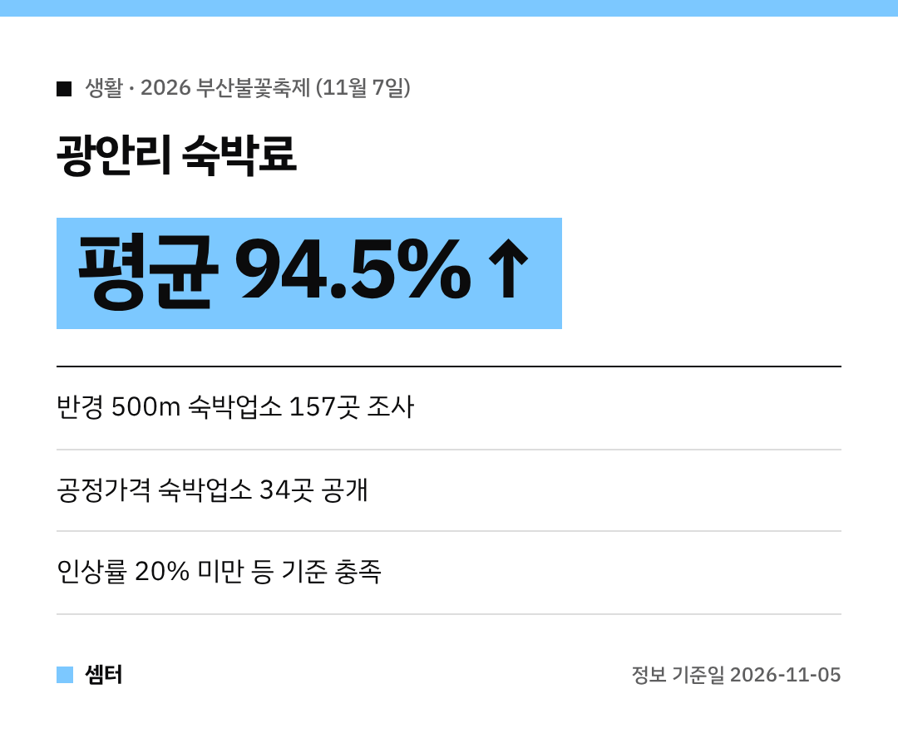

올해도 광안리 밤하늘이 불꽃으로 물들 예정이에요~! 🎆
**11월 7일** 부산불꽃축제를 앞두고 숙소 고민 중이시라면 꼭 보세요.

## 언제, 어디서?
**11월 7일** 광안리해수욕장 일대에서 열려요.

## 숙박료가 얼마나 올랐어요?
부산시가 온라인 숙박 예약 플랫폼 5곳을 조사했는데요.
행사장 반경 **500m 안 숙박업소 157곳**의 요금이 평균 **94.5%** 올랐대요 😱

| 인상률 | 업소 수 |
|---|---|
| 100% 미만 | 85곳 |
| 100% 이상~200% 미만 | 57곳 |
| 200% 이상 | 15곳 |

평소의 거의 두 배 가까이 된 셈이에요.

## 그래서 나온 '공정가격 숙박업소' 34곳
부산시가 아래 기준을 다 지킨 **34곳**을 골라 공개했어요.
- 요금 인상률 20% 미만
- 미리 안내한 요금을 지킴
- 위생 불편 신고·법령 위반 없음

명단은 부산시 관광 안내에서 확인해 보세요 👍

## 숙소 잡을 때 팁
예약한 뒤 업소가 "취소해 달라"고 연락해 오면 바로 응하지 말고 사정을 꼼꼼히 확인하세요.
결제 전에 최종 요금과 환불 규정도 꼭 보시고요!

다들 안전하게 불꽃 구경하시구! 오늘도 좋은 하루 보내세요~ㅎㅎ
