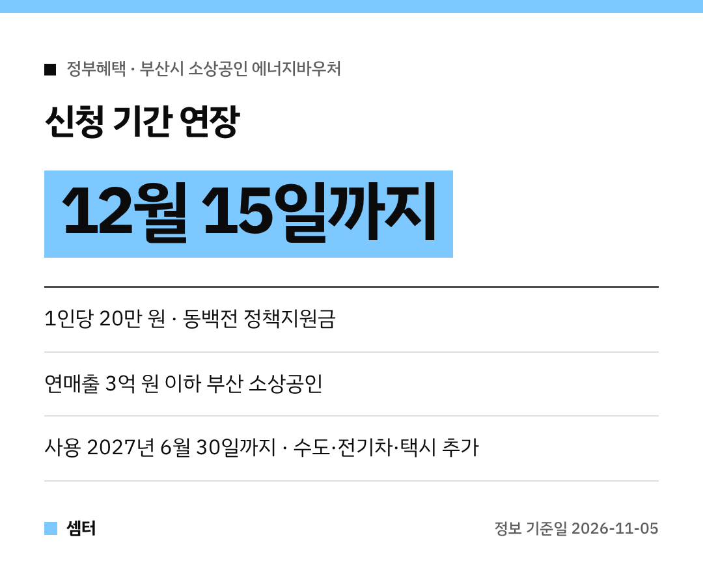

부산에서 가게 하시는 사장님들, 에너지바우처 아직 신청 안 하셨다면 다행이에요~!
**신청 기간이 늘어났어요** 😊

## 얼마나, 누가 받아요?
부산시가 9월 28일부터 소상공인에게 1인당 **20만 원**을 **동백전 정책지원금**으로 주고 있어요.
대상은 부산에 사업장이 있는 **연매출 3억 원 이하** 소상공인이에요.

## 신청·사용 기간이 늘었어요
| 구분 | 원래 | 바뀐 기간 |
|---|---|---|
| 신청 | 11월 6일까지 | **12월 15일까지** |
| 사용 | 2026년 12월 31일까지 | **2027년 6월 30일까지** |

원래 내일(11월 6일)이 마감이었는데, 한 달 넘게 여유가 생긴 거예요!

## 쓸 수 있는 곳도 늘었어요
전엔 전기요금과 차량 연료비(휘발유·경유·LPG)에만 쓸 수 있었는데요.
이제 **수도요금, 전기차 충전요금, 택시요금**까지 쓸 수 있어요 👍

전기차 충전은 나이스차저와 협약을 맺어서 **11월 9일부터** 결제할 수 있게 할 계획이래요.

## 잊지 말고 신청하세요
부산시도 "아직 신청하지 않은 소상공인은 기간 안에 꼭 신청해 달라"고 당부했어요.
12월 15일 전에 꼭 챙기세요~

다들 사업 번창하시구! 오늘도 좋은 하루 보내세요~ㅎㅎ
