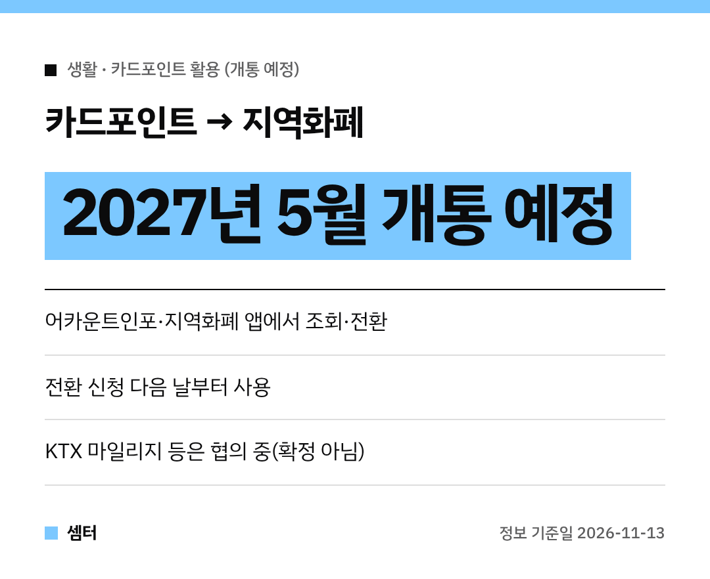

카드 쓰다 보면 포인트가 쌓여도 어디 쓸지 몰라서 그냥 두는 분들 많으시죠~
이 **카드포인트를 지역화폐로 바꿔 쓰는 서비스**가 생긴대요! 💳

다만 지금 바로는 아니고 **2027년 5월 개통 예정**이에요.

## 바꾸는 방법
금융결제원의 **어카운트인포**나 **지역화폐 앱**에서 내 카드포인트를 조회해요.
그다음 원하는 금액만큼 전환을 신청하면 돼요.

전환한 지역화폐는 **다음 날부터** 쓸 수 있대요.
전통시장이나 골목상권 가게에서 쓰는 거예요 😊

## 왜 카드포인트부터예요?
쓰지 않고 쌓인 카드포인트가 **2조 1000억 원**이나 된대요.
게다가 카드포인트는 이미 현금으로 바꾸는 체계가 잘 갖춰져 있어서 먼저 시작한다고 해요.

## 다른 포인트는 협의 중
KTX 마일리지, 탄소중립포인트 같은 공공기관 포인트도 지역화폐로 바꿀 수 있게 **협의를 추진 중**이에요.
아직 확정은 아니니 참고만 하세요!

유통·항공 같은 민간 업계도 스스로 참여하도록 유도해 대상을 차츰 넓힐 계획이래요.

## 어디서 나온 방안
11월 13일 국무총리 주재 제17회 국가정책조정회의에 보고된 '미사용 포인트 지역화폐 전환 추진방안'이에요.
6월 30일 국무회의 대통령 지시에 따라 국무조정실·행정안전부·금융위원회·금융결제원이 함께 만들었어요.

문의는 국무조정실 재정금융정책관실(044-200-2184)이에요.

그 전까지 카드포인트는 어카운트인포에서 미리 얼마나 있는지 확인해 두셔도 좋아요~
다들 알뜰하게 챙기시구! 오늘도 좋은 하루 보내세요~ㅎㅎ
