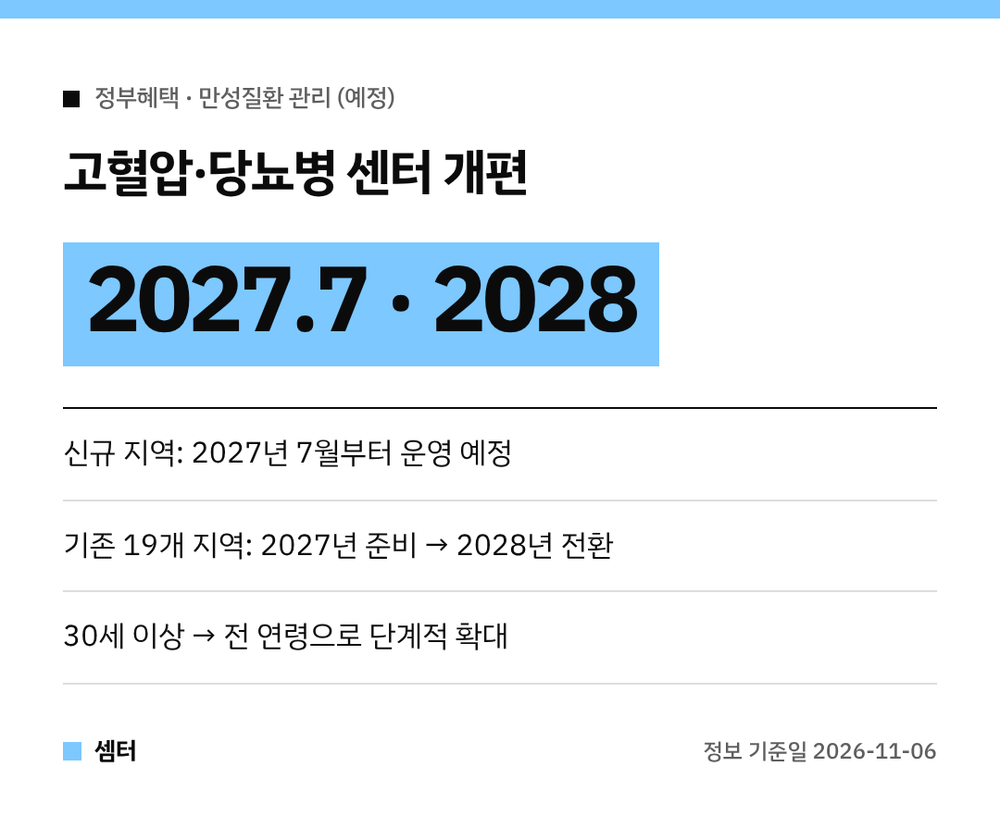

부모님이 고혈압이나 당뇨로 동네 센터에서 교육받고 계신가요?
그 센터가 앞으로 바뀔 예정이래요~

질병관리청이 11월 5일 **만성질환 통합관리센터** 전환 계획을 내놨어요.
아직 시행 전인 **예정** 내용이라 일정 위주로 정리했어요 😊

## 언제 바뀌어요?
지금 있는 **19개 지역 고혈압·당뇨병 등록교육센터**는 2027년을 준비 기간으로 보내요.
그다음 **2028년부터** 만성질환 통합관리센터로 바뀔 계획이에요.

새로 들어가는 지역은 2027년 상반기 공모로 뽑고, **2027년 7월부터** 센터를 운영할 예정이에요.

## 기존 센터 다니는 분들은?
2027년 동안은 센터 이름도 그대로고, 교육·상담·알림 같은 관리도 계속돼요.
갑자기 끊기는 건 아니니 안심하세요!

다만 **의료비 지원 방식**은 바뀌어요.
기존 등록환자 의료비 지원은 **건강생활실천지원금** 방식으로 넘어간대요.

지자체와 센터에서 바꾸는 방법을 안내해 준다고 하니, 다니는 센터 안내를 꼭 챙겨 보세요.

## 대상도 넓어져요
지금은 30세 이상이 대상이었는데, 앞으로 **전 연령**으로 넓힐 계획이에요.
관리 질환도 고혈압·당뇨병에서 **이상지질혈증** 등으로 늘린대요.

궁금한 점은 질병관리청 만성질환예방과(043-719-7444)에 물어볼 수 있어요.

다들 건강 잘 챙기시구! 오늘도 좋은 하루 보내세요~ㅎㅎ
