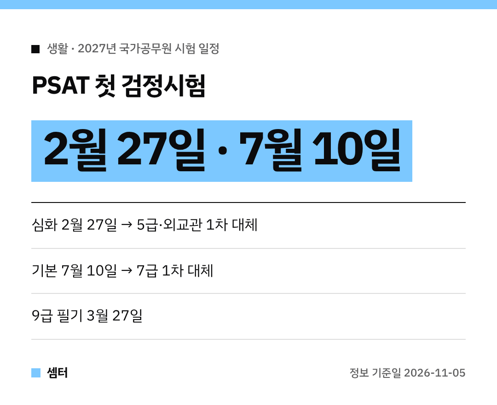

공시생 여러분, 내년 시험 달력 드디어 나왔어요!
특히 내년부터 **PSAT가 검정시험 형태로 처음** 따로 치러져서 꼭 챙겨 보셔야 해요~

인사혁신처가 11월 5일 발표한 내용 정리해 봤답니다 📚

## 한눈에 보는 일정
| 시험 | 날짜 |
|---|---|
| PSAT 심화 | **2월 27일** |
| 9급 공채 필기 | **3월 27일** |
| PSAT 기본 | **7월 10일** |

PSAT 원서는 응시 수수료 없이 국가채용시스템에서 내면 돼요.

## PSAT가 1차 시험을 대신해요
5급 공채·외교관후보자 1차 시험은 PSAT **'심화'** 성적으로 대신해요.
7급 1차 시험은 PSAT **'기본'** 성적으로 대신하고요.

## 원서는 두 번 내야 해요!
여기서 놓치기 쉬운 포인트예요.
PSAT 접수와 별도로, 보려는 채용시험 원서도 따로 내야 해요.

- 5급·외교관후보자: 3월 4일 ~ 8일
- 7급: 7월 12일 ~ 16일

## 문항마다 점수가 달라져요
내년 PSAT부터 **차등 배점**이 들어가요.
상·하 난이도 각 15% 범위에서 문항별 점수가 달라요.

- 심화: 상 3.5점 · 중 2.5점 · 하 1.5점
- 기본: 상 5점 · 중 4점 · 하 3점

## 영어·한국사 성적 마감일도 바뀌어요
지금까지는 '1차 시험 전날'까지 나온 성적을 인정했어요.
내년부터는 **각 채용시험 원서접수 마감일까지** 발표된 성적만 돼요.

그래서 5급·외교관은 3월 8일까지, 7급은 7월 16일까지 나온 성적이어야 해요.
9급 한국사는 한국사능력검정시험 성적으로 대신해요(3급 이상).
필기시험 전날까지 나온 등급만 인정돼요.

## 선발 인원은 언제?
직렬별 선발 인원, 과목, 응시 자격은 **내년 1월 초** 공고 예정이에요.
국가공무원채용시스템(gongmuwon.gosi.kr)과 인사처 누리집에서 확인하면 돼요.

다들 끝까지 힘내시구! 오늘도 좋은 하루 보내세요~ㅎㅎ
