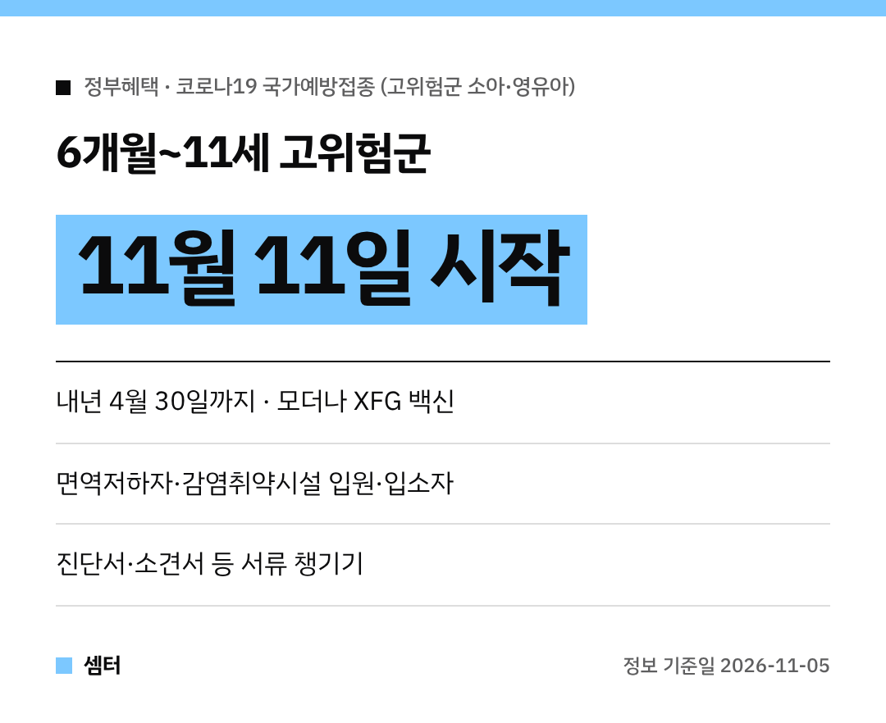

면역이 약한 아이를 키우는 부모님들 많이 기다리셨던 소식이에요~
그동안 12세 미만 아이가 맞을 수 있는 코로나19 백신이 국내에 없었거든요.

이제 **11월 11일부터** 고위험군 아이도 국가예방접종으로 맞을 수 있게 됐답니다 😊

## 언제부터 언제까지?
기간은 **11월 11일부터 내년 4월 30일까지**예요.
나이는 **6개월~11세**가 대상이에요.

백신은 식품의약품안전처가 10월 28일 긴급 도입한 **소아·영유아용 모더나 XFG 백신**을 써요.
국내 허가 백신이 없던 12세 미만 고위험군을 위해 들여온 거래요.

## 우리 아이도 대상일까?
모든 아이가 맞는 건 아니고, 고위험군만 대상이에요.

- 면역저하자
- 요양병원·요양시설 입원·입소자
- 정신건강증진시설 입원·입소자
- 장애인 및 노숙인 생활시설 입원·입소자

## 몇 번 맞아야 해요?
아이마다 달라요!
기초접종을 안 끝낸 아이는 먼저 기초접종을 1~2회 마쳐야 해요.

기초접종을 끝냈다면 매년 1회 맞아요.
면역저하자는 매년 2회예요.

예전에 몇 번 맞았는지에 따라 횟수가 바뀔 수 있어서, 꼭 의료진과 먼저 상담하세요.

## 갈 때 챙길 서류
진단서·소견서·시설 입소 확인서처럼 접종 대상인 걸 보여 주는 서류를 챙겨 가요.
의사가 면역저하자로 판단하면 서류 없이도 맞을 수 있대요.

접종 뒤에는 병원에서 20~30분 정도 머물며 아이 상태를 지켜봐 주세요.
집에 와서는 푹 쉬게 해 주시고요!

## 어느 병원에서 맞아요?
질병관리청 **예방접종도우미 누리집(nip.kdca.go.kr)**에서 찾을 수 있어요.
'예방접종관리' 메뉴의 '위탁의료기관 찾기'를 누르면 돼요.

궁금한 점은 질병관리청 예방접종관리과(043-719-8365)에 물어보면 된답니다.

## 65세 이상 부모님도 아직이라면
11월 4일 오후 6시 기준 65세 이상 접종 참여자는 약 391만 명이래요.
접종률로는 34.2%라서 아직 안 맞으신 분이 더 많아요.

부모님께도 한번 여쭤봐 주세요~

다들 아이들이랑 건강한 겨울 보내시구! 오늘도 좋은 하루 보내세요~ㅎㅎ
