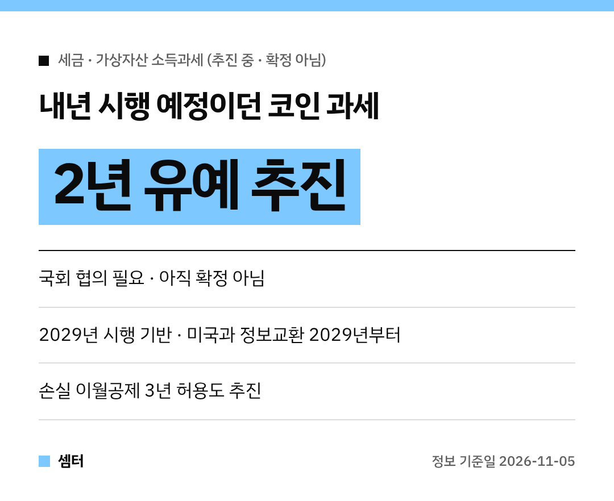

코인 하시는 분들 오늘 이 뉴스 보고 깜짝 놀라셨죠~
내년부터 시작될 예정이던 **가상자산 세금을 2년 미루는 방안**이 나왔어요!

다만 아직 **확정은 아니에요**.
정부가 국회와 협의해서 추진하겠다는 단계랍니다 😊

## 무슨 발표였어요?
11월 5일 이형일 부총리 겸 재정경제부 장관이 브리핑을 열었어요.
내년부터 시행 예정인 가상자산 소득과세를 **2년간 유예**하는 방안을 국회와 협의해 추진한다고 밝혔어요.

정책브리핑은 이걸 **2029년 시행 기반 마련**이라고 정리했어요.

## 왜 미루려는 거예요?
가장 큰 이유는 해외 거래 정보예요.
미국과 가상자산 정보를 주고받는 체계(CARF)가 **2029년부터** 돌아가거든요.

그 전에 과세하면 해외 거래는 잘 안 잡히고 국내 시장만 불리해질 수 있다는 거죠.
디지털자산법이 만들어지면 업계 제도도 크게 바뀌니, 2년 더 준비하겠다는 거예요.

## 손실 이월공제도 추진
코인은 가격이 확확 바뀌잖아요.
그래서 **손실을 3년 동안 이월해서 공제**해 주는 제도도 추진한대요.

미국·영국 같은 나라도 인정하는 방식이래요.
이것도 국회와 협의해야 하는 단계예요!

## 앞으로 일정
- 전문가·업계·관계부처가 모인 워킹그룹을 만들어 내년 상반기까지 집중 논의
- 법을 고쳐야 하는 부분은 2027년 정기국회에 개정안 제출 계획
- 2028년 상반기 세부 과세기준 발표 예정

## 지금 뭘 하면 될까요?
당장 바뀌는 건 없어요.
유예는 국회에서 법이 바뀌어야 확정되니, 연말 국회 소식을 계속 지켜보는 게 좋아요.

거래 내역은 지금부터 거래소별로 잘 모아 두면 나중에 신고할 때 편하답니다~

다들 현명한 투자 하시구! 오늘도 좋은 하루 보내세요~ㅎㅎ
