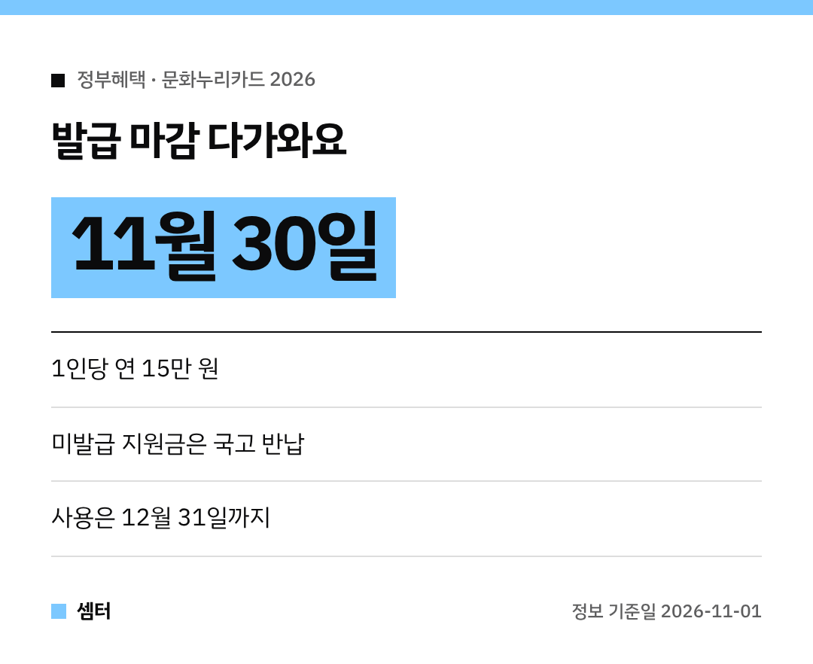

문화누리카드 아직 안 만드셨다면 지금 꼭 챙기셔야 해요~!
**2026년 발급 기한이 11월 30일**이랍니다 😊

기한 안에 발급받지 않으면 지원금이 **전액 국고로 반납돼서 사라져요**.
주변에 대상자 있으면 꼭 알려 주세요!

## 문화누리카드가 뭐예요?
문화예술, 국내여행, 체육활동에 쓸 수 있는 **문화복지 카드**예요.
삶의 질을 높이고 문화 격차를 줄이려고 만든 사업이랍니다.

## 누가, 얼마나 받아요?
- **대상:** 6세 이상(2020년 12월 31일 이전 출생) **기초생활수급자·차상위계층**
- **금액:** 1인당 **연간 15만 원**

## 언제까지?
| 구분 | 기한 |
|---|---|
| 카드 발급 | **11월 30일(월)** |
| 지원금 사용 | **12월 31일** |

## 어디서 신청해요?
- 가까운 행정복지센터 방문
- 문화누리카드 누리집(www.mnuri.kr)
- 모바일 앱
- ARS 전화

편한 방법으로 하시면 돼요 🙂

## 경남에 사신다면: 잔액 0원 이벤트
경남문화예술진흥원이 **11월 1일부터 30일까지** 이벤트를 하고 있어요.
지원금을 다 쓰고 **'잔액 0원'을 인증**하면, 추첨으로 **올리브영 모바일 교환권**을 준대요.

참여는 홍보 포스터의 신청서 링크나 QR코드로 잔액 조회 화면 캡처를 내면 돼요.

다들 남은 15만 원 알차게 쓰시구! 오늘도 좋은 하루 보내세요~ㅎㅎ
