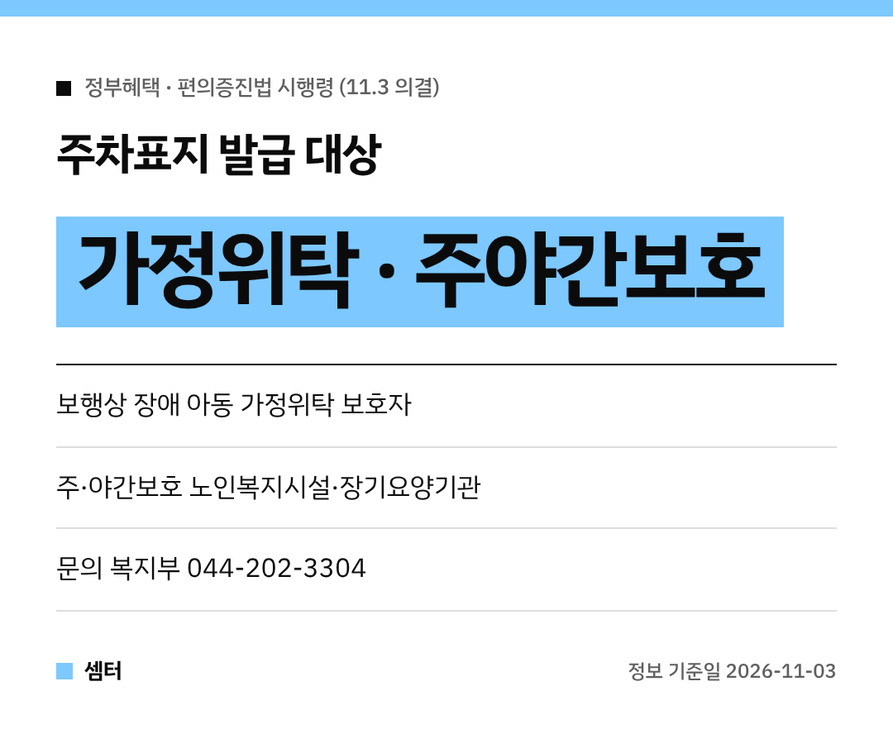

장애인전용주차구역 주차표지, 지금까진 "가족"이 아니면 받기 어려웠는데요~
이번에 받을 수 있는 사람과 시설이 넓어졌어요 😊

## 무슨 일이에요?
**11월 3일** 국무회의에서 '장애인·노인·임산부 등의 편의증진 보장에 관한 법률 시행령' 개정안이 의결됐어요.
주차표지 발급 대상과 시설 범위를 넓히는 내용이에요.

## 가정위탁 보호자도 받을 수 있어요
전엔 보호자용 주차표지를 받을 수 있는 보호자가 **민법상 가족 등**으로 한정돼 있었어요.
그래서 장애아동을 가정위탁으로 키우는 보호자는 빠져 있었대요.

이제는 **보행상 장애가 있는 아동을 가정위탁하는 보호자**도 발급 대상이에요 👍

## 주·야간보호 기관도 추가
어르신이 낮이나 밤에 다니시는 **주·야간보호서비스** 기관도 주차표지를 받을 수 있게 돼요.

- 노인복지법에 따른 주·야간보호서비스 재가노인복지시설
- 노인장기요양보험법에 따른 주·야간보호서비스 장기요양기관

흔히 '데이케어센터'라고 부르는 곳이 여기에 해당돼요.

## 경로당 화장실 기준도 조정
장애인 화장실 안 영유아용 거치대 설치 의무는 노인의료복지시설과 경로당에서는 적용하지 않을 수 있게 돼요.
시설 특성에 맞지 않는 의무를 손본 거래요.

## 궁금하면 어디로?
보건복지부 장애인권익지원과(044-202-3304)로 문의하면 돼요.
실제 발급이 언제부터 되는지는 시행령이 공포된 뒤 안내를 꼭 확인해 주세요!

다들 이동 편하게 다니시구! 오늘도 좋은 하루 보내세요~ㅎㅎ
