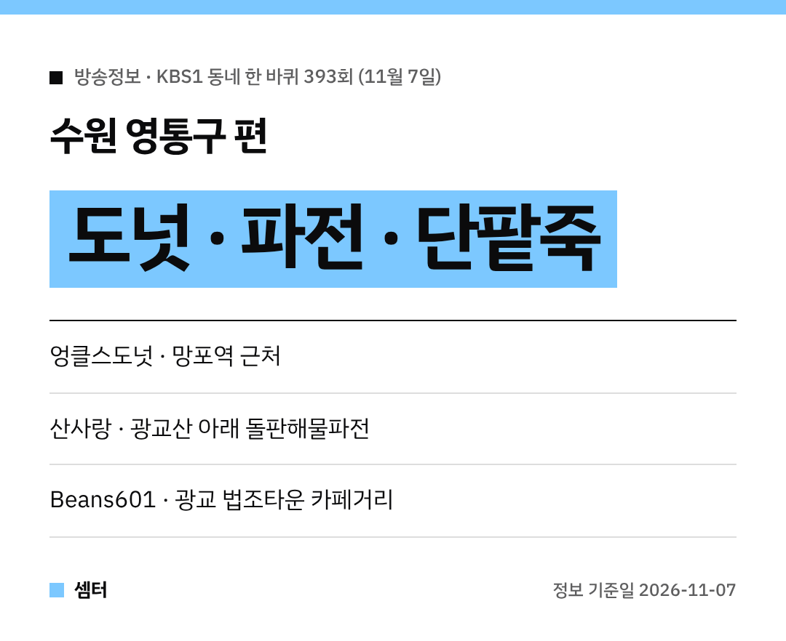

주말 저녁 '동네 한 바퀴' 보신 분들, 수원 영통구 편 맛있는 곳 많았죠~
11월 7일 KBS1 '동네 한 바퀴' 393회에 나온 곳을 한 번에 정리했어요 🍩

## 망포역 엉클스도넛
망포동에서 하루 한정 수량으로 수제도넛을 만드는 박현민·마현정 부부의 가게예요.
가게 이름은 **엉클스도넛**이에요.

일찍 매진되는 오픈런 가게라니 서둘러 가야겠죠!

[📍 네이버 지도에서 엉클스도넛 보기](https://map.naver.com/p/search/%EC%88%98%EC%9B%90%20%EB%A7%9D%ED%8F%AC%20%EC%97%89%ED%81%B4%EC%8A%A4%EB%8F%84%EB%84%9B)

## 광교산 아래 산사랑
광교산 아래 광교마루길 쪽 **산사랑**은 돌판해물파전과 손수제비 집이에요.
등산 끝나고 파전에 수제비면 딱이겠어요~

[📍 네이버 지도에서 산사랑 보기](https://map.naver.com/p/search/%EA%B4%91%EA%B5%90%EC%82%B0%20%EC%82%B0%EC%82%AC%EB%9E%91)

## 광교 법조타운 Beans601
광교 법조타운 카페거리의 **Beans601**은 김희정·조순영 모녀가 꾸려 가는 팥 카페예요.
단팥죽, 호두정과, 팥라테가 나왔어요 😊

[📍 네이버 지도에서 Beans601 보기](https://map.naver.com/p/search/%EA%B4%91%EA%B5%90%20Beans601)

## 같이 걸어 볼 곳
광교호수공원, 영흥수목원, 영통동 500년 느티나무도 이번 편에 나왔어요.
맛집 들르는 길에 가볍게 산책하기 좋아요!

[📍 네이버 지도에서 광교호수공원 보기](https://map.naver.com/p/search/%EA%B4%91%EA%B5%90%ED%98%B8%EC%88%98%EA%B3%B5%EC%9B%90)

다들 맛있는 주말 보내시구! 오늘도 좋은 하루 보내세요~ㅎㅎ
