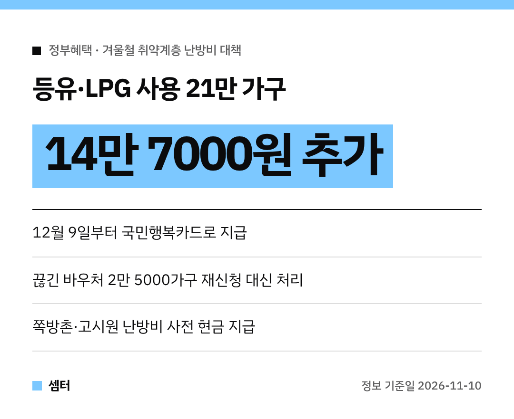

날이 부쩍 추워졌죠~ 난방비 걱정되는 분들께 반가운 소식이 있어요!
정부가 **겨울철 난방비 지원 대책**을 내놨답니다 😊

특히 **등유·LPG 쓰는 집**은 바우처가 더 늘어나니까 꼭 보세요.

## 끊긴 바우처, 정부가 먼저 연락해요
이사하거나 가족 수가 바뀌면 에너지바우처가 끊길 수 있어요.
그런데 어르신이나 장애인분들은 모르고 지나가기 쉽죠.

그래서 **'에너지바우처 찾아드림 서비스'**가 새로 생겼어요.
상담원이 직접 연락하고 담당 공무원이 재신청을 처리해 줘서, **행정복지센터에 안 가도** 다시 쓸 수 있어요.

대상은 내년 3월까지 사용이 중단된 **2만 5000여 가구**예요.

## 등유·LPG 가구는 14만 7000원 더
기름값이 오르면서 등유·LPG로 난방하는 **21만 가구**에 **14만 7000원** 상당의 바우처를 더 줘요.
평균 지원금이 **36만 7000원에서 51만 4000원**으로 늘어나요.

추가 지원금은 **12월 9일부터 국민행복카드**로 들어온대요.
따로 선불카드를 받던 방식이 국민행복카드 하나로 합쳐져서 더 편해졌어요!

## 쪽방촌·고시원은 현금으로 미리
월세에 난방비가 포함돼 있어서 바우처를 직접 쓰기 어려운 분들도 있죠.
이런 가구에는 겨울 전에 **난방비를 현금으로 미리** 준대요.

이번 달부터 미리 신청한 **500가구**에 먼저 시행해요.

## 집으로 찾아와 사용도 도와줘요
바우처를 받고도 못 쓴 집이 많대요.
집배원과 사회복지사가 직접 찾아가 카드 발급과 사용법을 알려주는 서비스가 **최대 12만 2000가구**로 늘어나요.

작년엔 한 푼도 안 쓴 집만 갔는데, 올해는 **절반도 못 쓴 집**까지 찾아간대요.

## 요금 밀려도 끊기지 않아요
- 도시가스: 기초생활수급자 등이 요금을 못 내도 **5월까지 공급중단 유예**
- 전기: **12월부터 내년 2월까지** 사용 제한 해제
- 지난해 바우처 기간 전기요금 체납액은 바우처 잔액으로 낼 수 있어요

올해 에너지바우처는 **144만 가구**, 예산 **5042억 원**으로 작년보다 늘었대요.
주변에 혼자 사시는 어르신 계시면 꼭 알려 드리시구! 오늘도 좋은 하루 보내세요~ㅎㅎ
