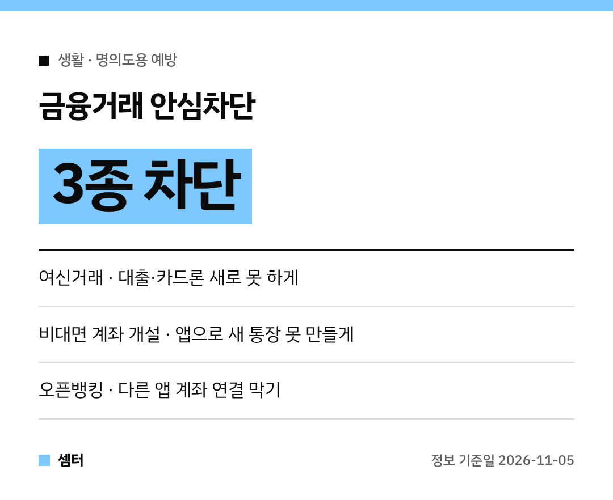

요즘 개인정보 유출 소식이 너무 자주 들리죠?
"혹시 내 이름으로 대출이라도 받으면 어떡하지…" 걱정되는 분들 많으실 거예요~

이럴 때 내가 직접 할 수 있는 게 바로 **금융거래 안심차단서비스**예요!
어떤 걸 막아 주는지, 어떻게 신청하는지 정리했어요 🔒

## 왜 지금 챙겨야 해요?
금융당국은 10월 6일 개인정보 유출에 따른 2차 피해를 경고하며 소비자경보 '주의'를 냈어요.
상대가 내 이름이나 대출 정보를 정확히 알아도 금융회사 직원이라고 믿으면 안 된대요.

## 안심차단은 3가지예요
이름은 비슷하지만 막는 게 서로 달라요.

**1. 여신거래 안심차단**
신용대출, 카드론, 할부금융, 예·적금 담보대출 같은 새 대출을 막아요.
신용카드 새로 만드는 것까지 막을지는 고를 수 있어요.

**2. 비대면 계좌 개설 안심차단**
스마트폰 앱이나 인터넷뱅킹으로 새 통장을 만드는 걸 막아요.
내 명의 통장이 범죄에 쓰이는 걸 대비하는 거예요.

**3. 오픈뱅킹 안심차단**
고른 금융회사 계좌를 다른 앱에 새로 연결할 수 없게 돼요.
이미 연결된 계좌도 오픈뱅킹 출금·조회가 막혀요.

## 오픈뱅킹은 꼭 확인하고!
간편결제나 지역사랑상품권 구매처럼 오픈뱅킹을 쓰는 서비스가 막힐 수 있어요.
평소 어떤 앱에서 어떤 계좌를 쓰는지 먼저 확인하고 범위를 정하세요.

## 어디서 신청해요?
은행 창구에 신분증 들고 가면 돼요.
은행 앱이나 '내계좌한눈에(payinfo.or.kr)'에서도 신청할 수 있어요.

## 신청한 다음엔
- 여신거래·비대면 계좌 차단 상태: 한국신용정보원 '크레딧포유(credit4u.or.kr)'
- 오픈뱅킹 차단 내역: '내계좌한눈에'

풀 때는 세 가지 모두 **영업점에 직접 가야** 해요.
대출이나 새 계좌가 필요할 땐 미리 해제 절차를 알아 두세요!

## 이미 정보가 새어 나갔다면
금융감독원 '파인(fine.fss.or.kr)'의 개인정보노출자 사고예방시스템에 등록할 수 있어요.
등록하면 금융회사에 공유돼서 새 계좌 개설, 카드 발급 같은 일부 거래가 제한돼요.

혹시 사기범에게 돈을 보냈다면 바로 경찰 112나 금융회사에 지급정지를 요청하세요.

다들 소중한 내 명의 꼭 지키시구! 오늘도 좋은 하루 보내세요~ㅎㅎ
