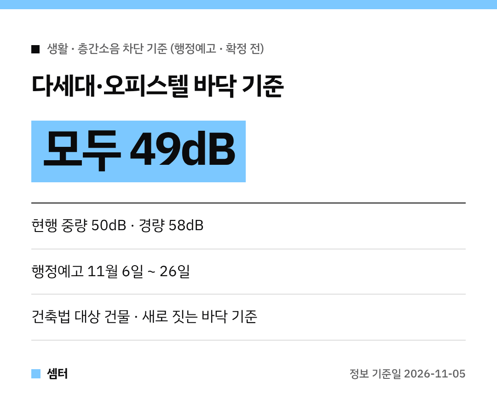

윗집 발소리, 의자 끄는 소리에 잠 못 드는 분들 많죠?
특히 빌라·오피스텔은 아파트보다 소리가 더 잘 들린다는 얘기가 많았어요~

이 부분 기준을 높이는 개정안이 나왔답니다!
아직 **행정예고 단계**라 확정 전이에요 😊

## 뭐가 바뀌어요?
다세대주택, 오피스텔 같은 **건축법 대상 건물**의 바닥 기준이 올라가요.
지금까지는 주택법을 따르는 공동주택보다 기준이 낮았거든요.

| 구분 | 지금 | 개정안 |
|---|---|---|
| 중량충격음 (쿵쿵 발소리) | 50dB 이하 | **49dB 이하** |
| 경량충격음 (물건 떨어지는 소리) | 58dB 이하 | **49dB 이하** |

특히 경량충격음은 58dB에서 49dB로 꽤 크게 내려가요!

## 언제까지 의견 낼 수 있어요?
국토교통부가 **11월 6일부터 26일까지** 행정예고해요.
이 기간에 의견을 받은 뒤 최종 확정하는 순서예요.

## 건축주는 뭘 고르나요?
강화된 기준에 맞춘 새 표준바닥구조와 완충재 품질기준도 함께 마련해요.
건축주는 성능시험을 거친 인정바닥구조나, 고시된 표준바닥구조 중 하나를 고를 수 있어요.

## 이미 사는 집도 바뀌나요?
이건 바닥을 만들 때 지켜야 하는 **차단구조 기준**이에요.
지금 사는 집 바닥이 바로 바뀌는 건 아니니 참고하세요!

궁금한 점은 국토교통부 녹색건축과(044-201-4753)에 물어보면 돼요.

다들 조용하고 편안한 밤 보내시구! 오늘도 좋은 하루 보내세요~ㅎㅎ
