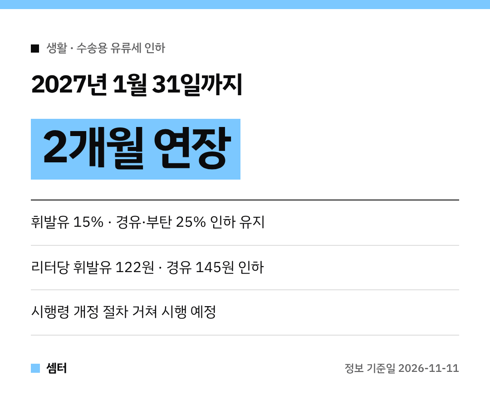

기름값 때문에 주유소 갈 때마다 한숨 나오셨죠~
다행히 **유류세 인하가 2개월 더 연장**된대요! ⛽

이번 달 말에 끝날 줄 알았던 분들 많으셨을 텐데, **내년 1월 31일까지** 이어져요.

## 얼마나 깎아 줘요?
인하율은 **지금 그대로** 유지돼요.

- 휘발유: **15%** 인하
- 경유: **25%** 인하
- 부탄: **25%** 인하

적용 기간은 **12월 1일부터 2027년 1월 31일까지**예요.

## 리터당으로 보면?
부가세 10%까지 포함하면 리터당 이만큼 싸져요.

- 휘발유 **122원**
- 경유 **145원**
- 부탄 **51원**

## 세율로 보면?
| 유종 | 인하 전 | 인하 후 |
|---|---|---|
| 휘발유 | 820원 | 698원 |
| 경유 | 581원 | 436원 |
| 부탄 | 203원 | 152원 |

## 왜 경유·부탄은 더 깎아줘요?
경유는 산업·물류에 꼭 필요하고, 부탄은 소형트럭 같은 **생계형 차량** 연료로 많이 쓰이잖아요.
그래서 상대적으로 높은 25%를 유지한대요.

## 아직 남은 절차가 있어요
정부는 '교통·에너지·환경세법 시행령'과 '개별소비세법 시행령' 개정안을 국무회의에 올리는 등 **절차를 거쳐 시행할 계획**이에요.

유류세 인하는 **2021년 11월** 처음 시작된 뒤 계속 연장돼 왔어요.
중동전쟁 불확실성과 고유가가 이어져서 이번에도 연장을 결정했대요.

다들 안전운전하시구! 오늘도 좋은 하루 보내세요~ㅎㅎ
