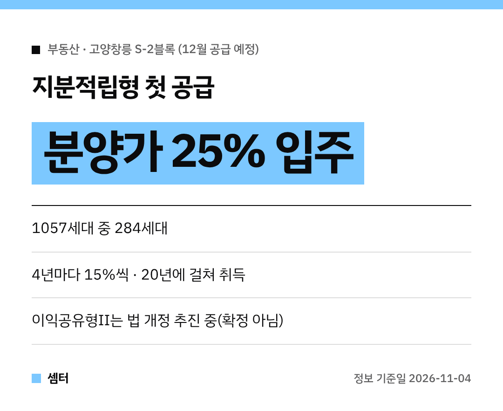

내 집 마련, 목돈이 제일 큰 벽이죠~
분양가의 **25%만 내고 입주**하는 지분적립형 주택이 드디어 처음 나온대요 🏠

## 어디에, 몇 세대?
국토교통부가 **12월** LH **고양창릉 S-2블록** 1057세대 가운데 **284세대**를 지분적립형으로 공급한대요.
11월 4일 발표된 내용이에요.

## 지분적립형은 어떤 구조예요?
입주할 때 **분양가의 25%**만 내고 집 지분을 사요.
나머지는 **4년마다 15%씩, 5번에 걸쳐** 사서 20년 동안 100%를 채우는 방식이에요.

아직 사지 않은 지분에는 주변 **전세 시세의 90%** 수준으로 임대료를 내요.
사정이 어려우면 지분 취득을 **최대 1년** 미룰 수도 있대요.

## 실제로 얼마 필요해요? (정부 예시)
| 항목 | 금액 |
|---|---|
| 기준 분양가 (수도권 평균, 전용 55㎡) | 5억 1000만 원 |
| 입주 때 지분 취득 비용 (25%) | **1억 2800만 원** |
| 미취득 지분 임대료 (전세 4억 가정) | 보증금 2억 7000만 원 **또는** 월 79만 원 |

LTV 40% 적용도 검토 중인데, 그렇게 되면 초기 자금이 7700만 원까지 줄어든대요.
다만 이건 아직 **검토 단계(확정 아님)**예요.

## 이익공유형Ⅱ는 아직 준비 중
분양가의 70%(한도 5억 원)를 주택도시기금에서 낮은 금리로 빌리고, 나중에 집값이 오르면 차익을 나누는 모델이에요.
금리는 디딤돌 대출 기본금리보다 1%p 낮게 잡는대요.

하지만 아직 **법적 근거가 없어서** 공공주택 특별법령 개정을 추진 중이에요.

## 문의
국토교통부 주택정책과(044-201-3329), 사업 시행은 LH 판매기획처(055-922-5133)예요.
정확한 입주자 모집공고가 나오면 자격 요건부터 꼭 확인하세요!

다들 내 집 마련 꿈 이루시구! 오늘도 좋은 하루 보내세요~ㅎㅎ
