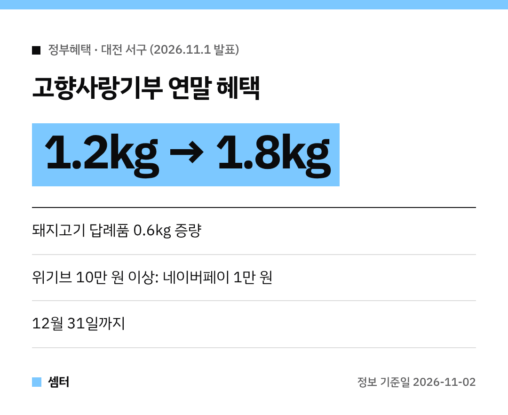

연말 고향사랑기부 어디에 할지 고민 중이셨다면, 대전 서구 소식 하나 챙겨 가세요~! 😊
**12월 31일까지** 답례품을 늘려 준대요.

## 혜택 ① 돼지고기 답례품 증량
행사 기간에 돼지고기 답례품을 고르면 **0.6kg이 추가**돼요.
기존 1.2kg에서 **총 1.8kg**을 받는 거예요.

## 혜택 ② 위기브에서 기부하면 네이버페이
민간 플랫폼 **'위기브'**에서 **10만 원 이상** 기부하면 **네이버페이 1만 원권**을 준대요.
세액공제와 답례품은 그대로 받고, 여기에 하나 더 얹어지는 셈이에요 🙂

다만 네이버페이는 **위기브의 별도 지급 조건**에 따른대요.
기부 전에 위기브 이벤트 안내를 꼭 확인해 주세요.

## 어디서 기부해요?
**고향사랑e음**이나 **위기브** 같은 참여 플랫폼에서 할 수 있어요.

## 잠깐, 고향사랑기부제가 뭐였죠?
내가 사는 곳이 아닌 **다른 지방자치단체에 기부**하면, 세액공제와 답례품을 받는 제도예요.
그래서 대전 서구에 사시는 분은 서구에는 기부할 수 없어요.

다들 따뜻한 연말 보내시구! 오늘도 좋은 하루 보내세요~ㅎㅎ
