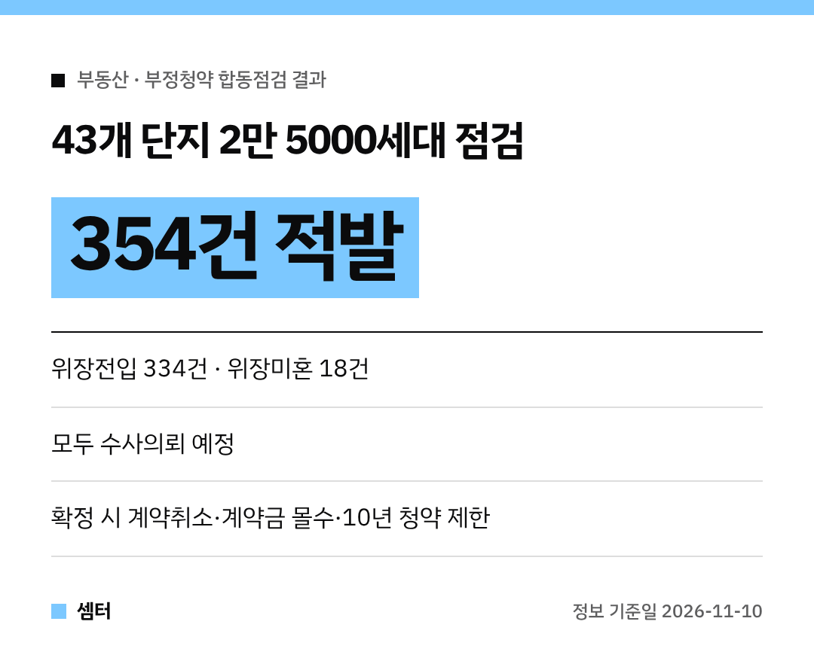

청약 준비하시는 분들, 이 소식은 꼭 보셔야 해요!
정부가 아파트 당첨자를 점검해서 **부정청약 의심사례 354건**을 잡아냈대요 😮

가장 많은 건 역시 **위장전입**이었어요.
어떤 경우가 걸렸는지, 걸리면 어떻게 되는지 정리해 봤어요.

## 얼마나 점검했어요?
국토교통부와 국무조정실이 관계부처와 함께 **서울 등 43개 단지, 2만 5000세대** 당첨자를 들여다봤어요.
특히 부양가족이 진짜 같이 사는지를 집중적으로 확인했대요.

지난해 상반기 점검(2만 8000호, 252건)보다 점검 대상은 줄었는데, 적발은 **40.5%** 늘었어요.
이번엔 점검 인력과 기간을 늘리고, 임신·장애 같은 자격이 맞는지, 서류 위조는 없는지도 봤대요.

## 어떤 유형이 걸렸어요?
- **위장전입 334건**: 해당 지역 거주 자격이나 무주택 자격을 얻으려고, 또는 부양가족 점수를 올리려고 거짓으로 전입신고
- **위장미혼 18건**: 집 있는 사람과 결혼하고도 혼인신고를 안 해서 무주택자처럼 청약
- **자격매매 1건**: 알선자와 짜고 대신 청약·계약한 뒤 돈을 주고받음
- **위장퇴사 1건**: 저소득 조건을 맞추려고 거짓으로 퇴사

## 실제 사례를 보면
분당에서 아내·아들과 사는 사람이, 여수에 사는 어머니와 경기 광주에 사는 장모를 자기 집으로 전입시켜 놓고 서울 아파트 가점제로 당첨된 경우가 있었대요.

부모님 주소만 옮겨 놓는 것도 **실제로 같이 살지 않으면 위장전입**이에요!

## 걸리면 어떻게 돼요?
적발된 354건은 **모두 수사의뢰**할 예정이에요.
부정청약으로 확정되면 이런 조치를 받아요.

- 형사처벌: **3년 이하 징역 또는 3000만 원 이하 벌금**
- **계약 취소** (주택 환수)
- **계약금 몰수** (분양가의 10%)
- **10년간 청약 자격 제한**

## 부동산 범죄 특별단속도
경찰은 지난해 10월 17일부터 올해 10월 31일까지 특별단속으로 **2151명을 송치하고 16명을 구속**했어요.
11월 1일부터는 3차 특별단속이 시작돼 내년 10월 31일까지 이어진대요.

괜히 꼼수 쓰다가 10년 동안 청약 못 하면 너무 손해겠죠?
정직하게 준비해서 꼭 당첨되시구! 오늘도 좋은 하루 보내세요~ㅎㅎ
