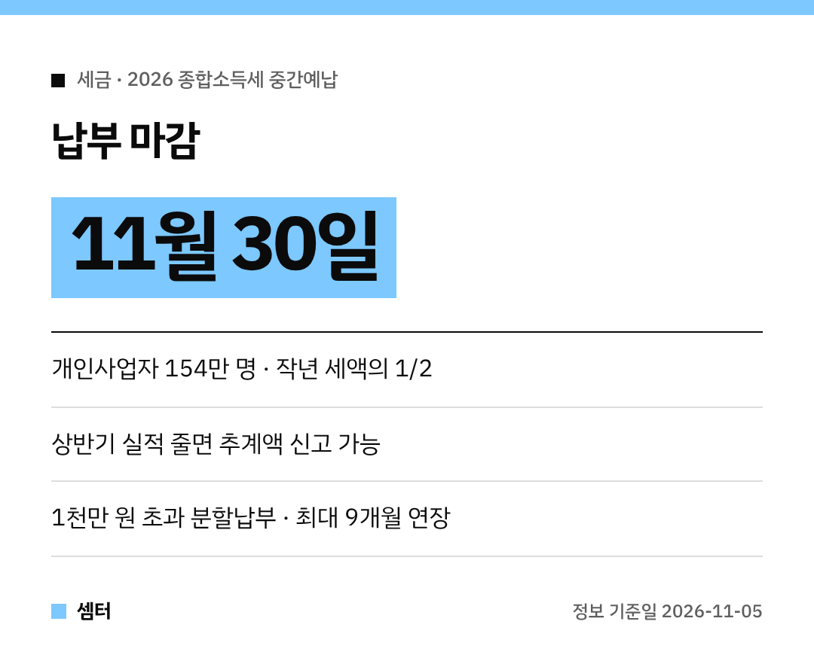

사장님들, 11월 고지서 받으셨나요~?
11월은 **종합소득세 중간예납**의 달이에요 😊 놓치면 가산세가 붙으니 꼭 챙기세요!

## 중간예납이 뭐예요?
국세청이 **11월 2일부터** 종합소득이 있는 개인사업자 **154만 명**에게 고지서를 보내고 있어요.
작년(2025년 귀속) 종합소득세의 **절반(1/2)**을 미리 내는 거예요.

여기서 낸 돈은 내년 소득세 신고 때 '미리 낸 세금'으로 빠져요.

## 언제까지 내요?
**11월 30일까지**예요!
늦으면 납부지연가산세(3% + 1일당 0.022%)가 붙어요.

## 고지서가 안 오는 경우
- 중간예납세액이 **50만 원 미만**
- 이자·배당·근로소득 등만 있는 경우
- 올해 새로 사업을 시작한 경우 등

## 상반기 매출이 확 줄었다면: 추계액 신고
올해 상반기 실적으로 계산한 추계액이 작년 세액의 **30%보다 적다면**, 고지된 금액 대신 추계액을 신고·납부할 수 있어요.
마감은 똑같이 11월 30일이에요 👍

## 금액이 크다면: 분할납부
1천만 원을 넘으면 **내년 2월 1일까지** 나눠 낼 수 있어요.

| 중간예납세액 | 나눠 낼 수 있는 금액 |
|---|---|
| 2천만 원 이하 | 1천만 원을 넘는 부분 |
| 2천만 원 초과 | 세액의 50% 이하 |

## 정말 어렵다면: 납부기한 연장
자연재해나 사업 부진으로 힘든 사업자는 홈택스나 세무서에 신청하면 **최대 9개월**까지 미룰 수 있대요.

다들 꼼꼼하게 챙기시구! 오늘도 좋은 하루 보내세요~ㅎㅎ
