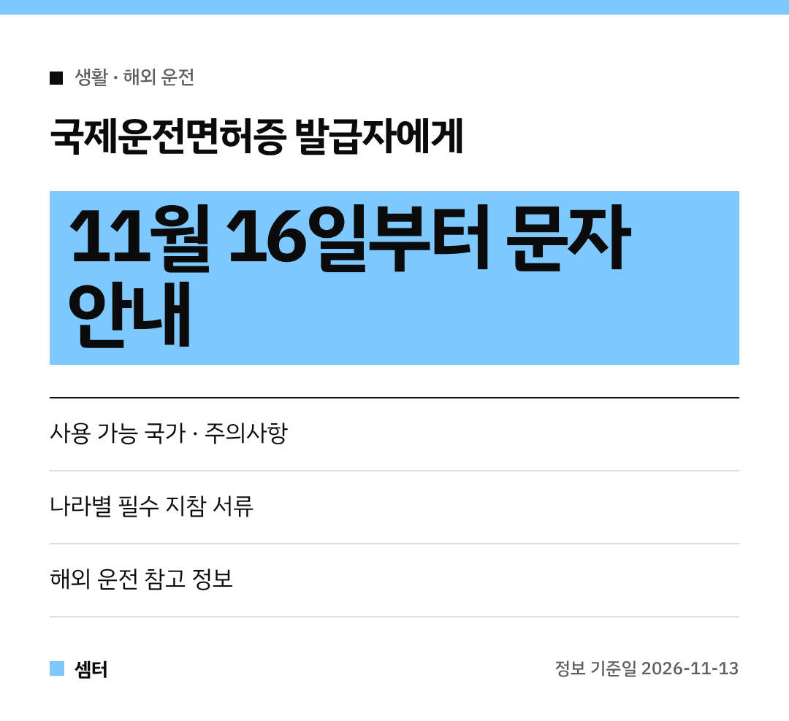

해외여행 가서 렌터카 빌리려는 분들 주목이에요~
이제 국제운전면허증만 발급받으면 **해외 운전 유의 사항을 문자로** 알려 준대요! 🚗

**11월 16일부터** 시작하는 서비스예요.

## 뭐가 달라져요?
지금까지는 어느 나라에서 국제운전면허증을 쓸 수 있는지 한국도로교통공단 누리집에서 직접 찾아봐야 했어요.
나라별 운전 주의사항은 또 대사관(재외공관) 누리집을 따로 뒤져야 했고요.

이제는 국제운전면허증을 **발급받는 단계에서** 필요한 정보를 문자로 한 번에 받아요~

## 문자로 오는 내용
- 국제운전면허증 **사용 가능 국가**와 주의사항
- **나라별 운전 시 필수 지참 서류** (나라마다 달라요)
- 해외 운전 관련 참고 정보

## 기본으로 챙길 서류 3가지
해외에서 운전할 땐 기본적으로 **국제운전면허증, 여권, 국내 운전면허증** 세 가지가 필요해요.
여기에 나라마다 추가로 들고 다녀야 하는 서류가 있어서, 문자로 그걸 미리 알려 주는 거예요 📝

국내 운전면허증은 집에 두고 가기 쉬우니 꼭 같이 챙기세요!

## 누가 하는 서비스예요?
재외동포청이 경찰청, 한국도로교통공단과 함께 하는 서비스예요.
대사관이 나라별 운전 정보를 누리집에 올리면, 그 내용이 도로교통공단 알림과 연결되는 방식이래요.

## 문의
- 재외동포청 재외동포서비스지원센터 02-6399-7155
- 경찰청 교통기획과 02-3150-2253

다들 안전 운전하시구! 오늘도 좋은 하루 보내세요~ㅎㅎ
