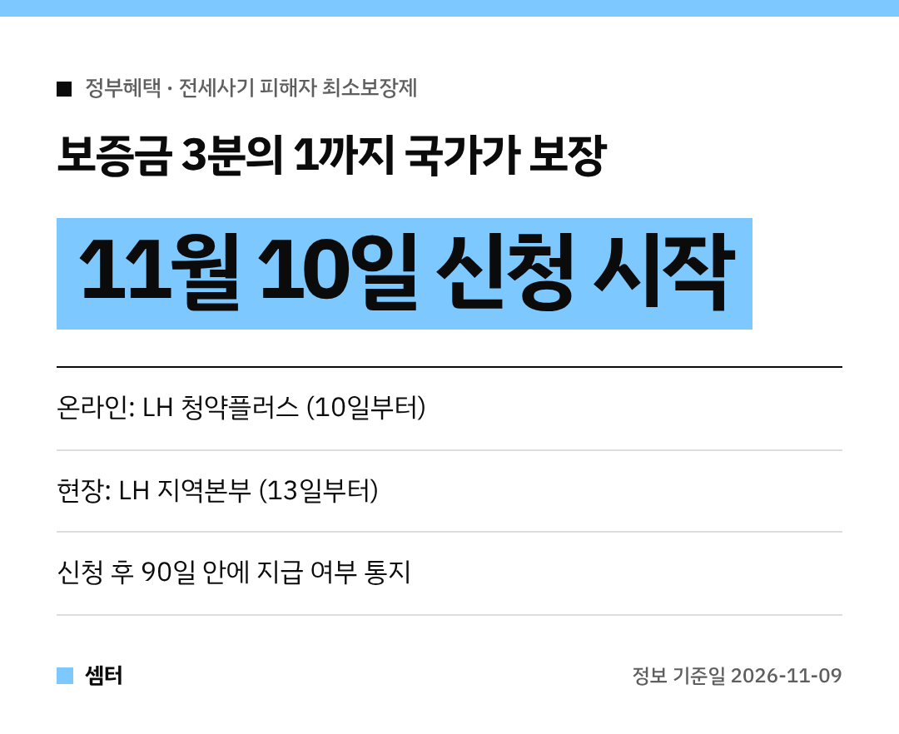

전세사기 피해 때문에 마음고생하신 분들께 꼭 전하고 싶은 소식이 있어요.
**보증금의 3분의 1은 국가가 보장**해 주는 '최소보장제'가 곧 시작돼요!

온라인 신청은 **11월 10일**부터예요.
대상인지, 어떻게 신청하는지 차근차근 정리해 봤어요 😊

## 최소보장제가 뭐예요?
국토교통부가 **11월 13일**부터 시행하는 제도예요.
전세사기 피해자의 최소한의 피해회복을 국가가 보장해 준대요.

제도는 두 가지로 나뉘어요.
**최소지원금**, 그리고 신탁사기 같은 무권계약 피해자를 위한 **선지급-후정산**이에요.

## 최소지원금은 얼마나 받아요?
경매 등으로 돌려받은 돈이 보증금의 3분의 1이 안 되면, 그 **부족한 만큼을 현금으로** 채워 줘요.
계산은 간단해요.

보증금의 3분의 1에서 이미 돌려받은 돈(피해회복금)을 빼면 돼요.
피해회복금에는 경매 배당액, 임대인에게 돌려받은 돈, 경매차익 지원액, 임대료 지원액이 들어가요.

## 누가 받을 수 있어요?
특별법에 따라 전세사기피해자로 결정된 분이 대상이에요.
보증금 **5억 원 이하**로 피해자 등으로 인정된 임차인도 포함돼요.

둘 다 돌려받은 돈이 보증금의 3분의 1에 못 미쳐야 해요!

## 신탁사기 피해자는 먼저 받을 수 있어요
집을 빌려줄 권한이 없는 사람과 계약한 분들을 무권계약 피해자라고 해요.
신탁사기가 대표적이에요.

이런 분들은 집 처분이 끝나기 전이라도 **보증금의 3분의 1을 먼저** 받을 수 있어요.
이미 돌려받은 돈이나 임대료 지원액이 있으면 그만큼은 빼고 줘요.

## 언제 신청할 수 있어요?
- **최소지원금**: 피해주택 경·공매가 끝난 뒤 (LH가 집을 사는 경우엔 경매차익 산정이 끝난 뒤)
- **선지급금**: 경·공매가 끝나기 전에도 신청 가능

## 어디서 신청해요?
- 온라인: **LH 청약플러스(apply.lh.or.kr)**, 10일부터
- 현장: **LH 지역본부**, 13일부터
- 문의: LH 콜센터 **1600-1004**

## 신청 뒤엔 어떻게 돼요?
LH가 신청일로부터 **90일 안에** 지급 여부를 알려 줘요.
서류 보완이 필요하면 30일 늘어날 수 있어요.

결과에 동의하기 어려우면 통지받은 날부터 **30일 안에** LH에 이의신청을 하면 돼요.

혼자 끙끙 앓지 마시고 꼭 신청해 보시구! 오늘도 좋은 하루 보내세요~ㅎㅎ
