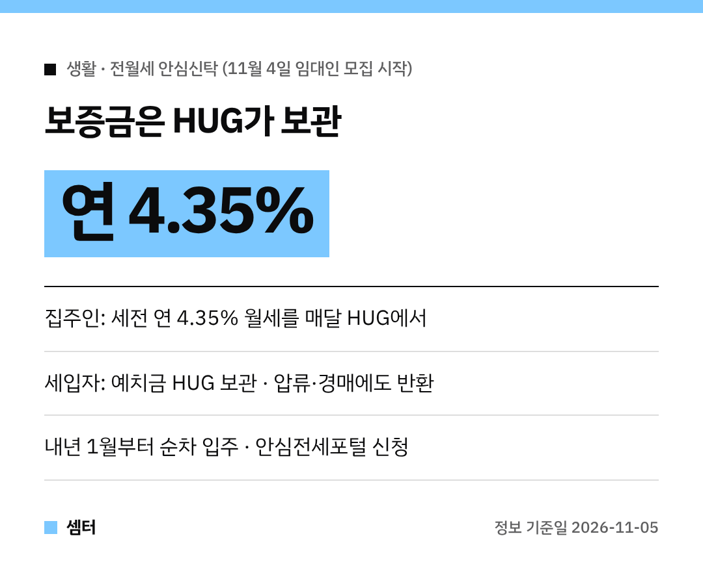

전세사기 뉴스 볼 때마다 불안하셨죠?
집주인 입장에서는 월세 밀릴까 봐 걱정이고요~

그래서 정부가 둘 다 덜어 주는 **전월세 안심신탁**을 시작했어요!
11월 4일부터 첫 집주인(임대인) 모집에 들어갔답니다 😊

## 어떻게 돌아가는 구조예요?
집주인, 주택도시보증공사(HUG), 세입자 셋이 함께 계약해요.

세입자는 보증금만큼의 돈(예치금)을 집주인이 아니라 **HUG에 맡겨요**.
HUG는 이 돈을 굴려서 집주인에게 **매달 월세 형태로** 돈을 줘요.

계약이 끝나면 HUG가 세입자에게 예치금을 직접 돌려줘요.
그러니 보증금 떼일 걱정이 확 줄어드는 거죠!

## 집주인은 얼마 받아요?
이번 공고의 약정 수익률은 **세전 연 4.35%**예요.
계약 기간 내내 HUG가 매달 넣어 주니 월세 연체 걱정이 없어요.

계약이 끝나고 다음 세입자 들어오기 전 공실이 생기면, 안심신탁을 이어 가는 조건으로 최대 2개월 치를 HUG가 챙겨 줘요.

## 세입자에게 좋은 점
- 예치금은 HUG가 보관해서, 집이 압류·경매돼도 HUG가 100% 돌려줘요
- 주택임대차보호법이 그대로 적용돼요(계약갱신청구권, 임대료 증액 5% 제한, 대항력)
- 전세보증금반환보증 가입이 필요 없어서 보증료 부담도 줄어요

돈은 계약금으로 예치금의 10%, 입주 때 나머지 90%를 HUG 전용 계좌에 내요.
예치금 전용 전세대출이 생기고, 요건이 맞으면 버팀목 대출도 쓸 수 있게 연내 절차를 마칠 예정이래요.

## 아무 집이나 되나요?
소득·자산 기준은 집주인, 세입자 모두 없어요.
대신 집에는 조건이 있어요.

- 주택가격 **20억 원 이하**
- 기존 선순위 부채비율이 주택가격의 **80% 이하**
- 예치금은 적정 전세 시세 이내

아파트·빌라 같은 주택 유형 제한은 없대요.
계약은 법무법인 입회 아래 공인중개사 중개로 맺어요.

## 세금 혜택은 아직 확정 아니에요
HUG가 주는 월세 소득에 소득세·법인세 50% 감면, 농어촌특별세(20%) 비과세를 해 주겠다고 했어요.
다만 이건 **법 개정이 필요해서 아직 추진 중**이에요.

2027년 임대소득은 2028년 5월에 신고하니까, 그 전까지 법을 고치겠다는 계획이래요.

## 신청은 어디서?
집주인은 지금부터 상시로 **안심전세포털(khug.or.kr/jeonse)**이나 전국 HUG 지사에서 신청하면 돼요.
세입자를 아직 못 구했어도 신청할 수 있어요.

요건 확인, 3자 계약, 예치금 납부를 거쳐 **내년 1월부터 순차적으로 입주**할 수 있대요.
문의는 HUG 안심신탁기획실(051-998-6821)이에요.

다들 안심하고 집 구하시구! 오늘도 좋은 하루 보내세요~ㅎㅎ
