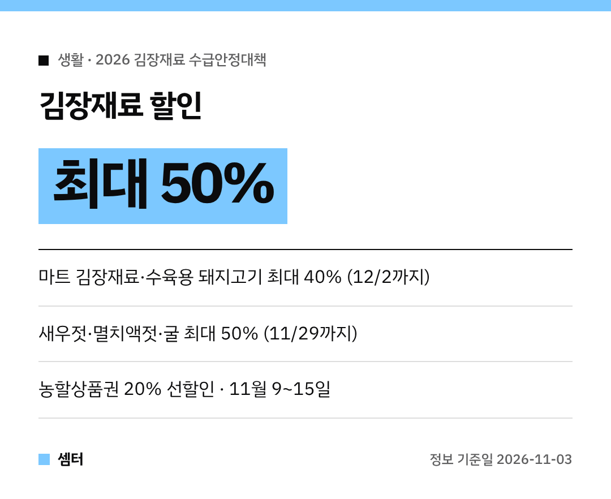

김장철이 다가왔어요~!
올해는 정부가 김장재료 할인에 **역대 최대 640억 원**을 쓴대요 😊 언제 어디서 싸게 살 수 있는지 정리해 봤어요.

## 올해 배추·무 사정은?
가을배추는 **121만 4000톤**, 가을무는 **37만 2000톤**으로 작년보다 각각 18.5%, 11.1% 많을 전망이래요.
마늘·새우젓처럼 일부 양념은 생산이 줄었지만, 김장철 공급은 충분할 거라고 해요.

4인 가구 김장 규모는 평균 **23.4포기**로 작년과 비슷하대요.

## 할인 ① 마트에서 최대 40%
대형·중소형마트에서 **김장재료 전 품목과 수육용 돼지고기**를 최대 40% 할인해요.
기간은 **10월 29일부터 12월 2일까지**예요.

김장 날 수육까지 한 번에 장 보면 딱이겠죠?

## 할인 ② 새우젓·굴은 최대 50%
'대한민국 수산대전_김장 특별전'이 **11월 29일까지** 열려요.
천일염, 새우젓, 멸치액젓, 굴 등을 **최대 50%** 할인해요 🦐

## 할인 ③ 전통시장 갈 땐 농할상품권
전통시장 등에서 쓰는 농할상품권을 **20% 싸게** 미리 살 수 있어요.

| 대상 | 구매 기간 |
|---|---|
| 고령층 | 11월 2일 ~ 8일 |
| 전체 소비자 | **11월 9일 ~ 15일** |

할인 한도는 **최대 10만 원**이에요.

## 안심하고 사도록
수입김치·양념채소 원산지 거짓표시는 **12월 5일까지** 단속하고, 배추·무·고추·마늘은 잔류농약 검사를 800건 한대요.

## 문의
농림축산식품부 농식품시장관리과(044-201-2685), 수산물은 해양수산부 유통정책과(044-200-5447)예요.

다들 맛있는 김장 하시구! 오늘도 좋은 하루 보내세요~ㅎㅎ
