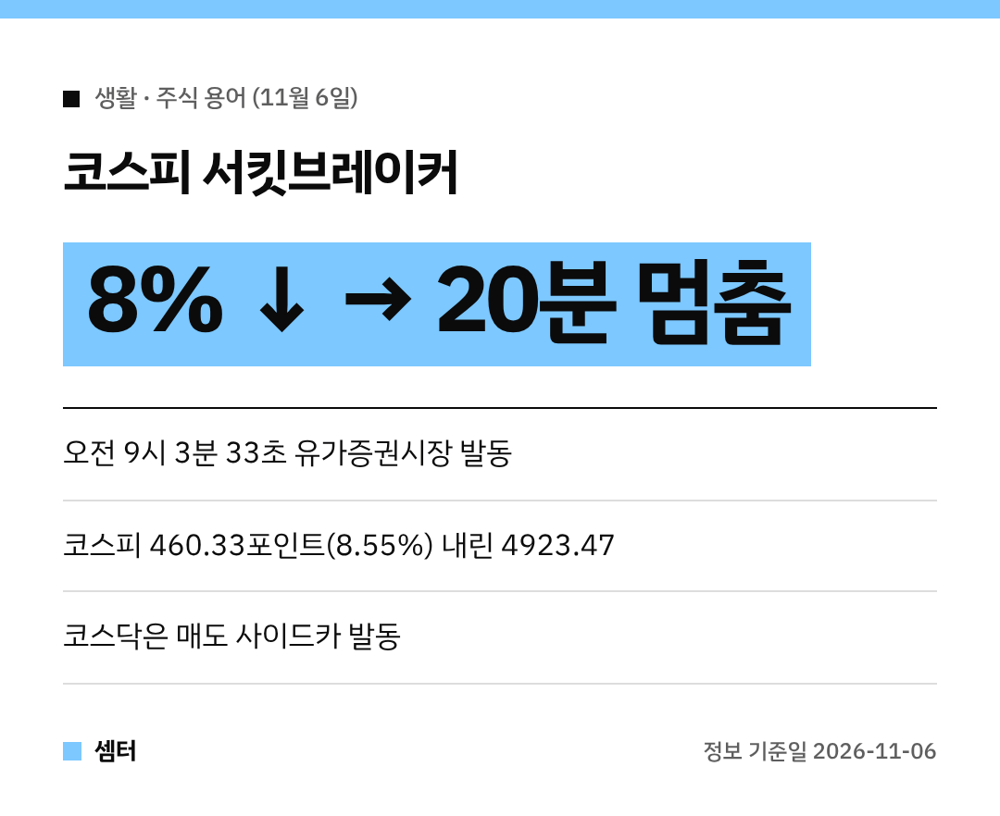

오늘 아침 주식 앱 열어 보고 깜짝 놀라셨죠?
코스피에 **서킷브레이커**가 걸렸어요!

뉴스에 자꾸 나오는 서킷브레이커랑 사이드카가 뭔지, 오늘 무슨 일이 있었는지 쉽게 정리해 봤어요.
(투자 권유가 아니라 용어와 상황 정리예요~)

## 서킷브레이커가 뭐예요?
전기 차단기(서킷 브레이커)처럼 시장이 너무 과열되면 잠깐 전원을 내리는 장치예요.
지수가 **전일 종가보다 8% 넘게 떨어진 상태가 1분 동안 이어지면**, 그 뒤 **20분 동안 매매를 멈춰요**.

공포에 휩쓸린 매도를 잠깐 식히라는 뜻이에요.
20분 지나면 거래는 다시 열려요.

## 오늘 무슨 일이 있었나요?
한국거래소는 **오전 9시 3분 33초**에 유가증권시장 서킷브레이커(1단계)를 발동했어요.
그때 코스피는 460.33포인트(8.55%) 내린 4923.47이었어요.

이에 따라 코스피 현물과 선물 거래가 20분 동안 멈췄답니다.
간밤 미국 반도체주가 크게 떨어진 영향이 컸다는 분석이에요.

## 사이드카는 또 뭐예요?
코스닥 시장에는 **매도 사이드카**가 발동됐어요.
사이드카는 선물 가격이 크게 움직일 때 **프로그램 매도 주문의 효력을 잠깐 멈추는** 장치예요.

서킷브레이커가 시장 전체를 멈추는 거라면, 사이드카는 컴퓨터가 자동으로 내는 매도 주문만 잠깐 붙잡는 거죠.

## 이럴 때 기억할 것
- 서킷브레이커 중에는 주문을 내도 체결이 안 돼요
- 재개 직후엔 가격이 크게 출렁일 수 있어요
- 급하게 판단하기보다 공시와 뉴스를 차분히 확인하세요

다들 마음 단단히 붙잡으시구! 오늘도 좋은 하루 보내세요~ㅎㅎ
