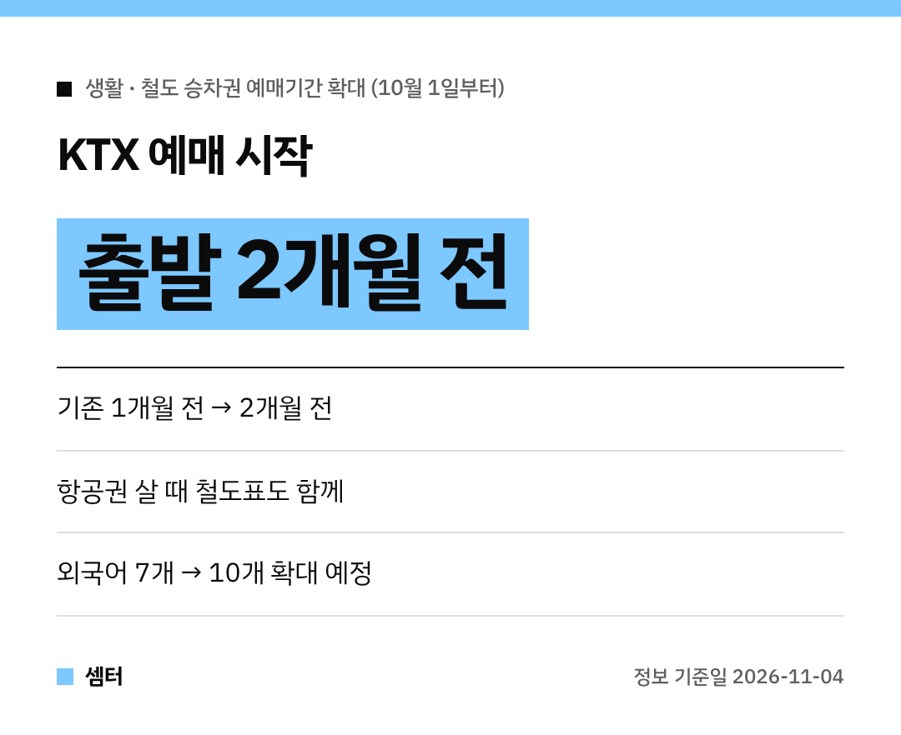

연말이나 겨울방학에 기차 여행 계획하시는 분들, 표 구하기 전쟁 걱정되시죠~?
이제는 훨씬 여유 있게 잡을 수 있어요 🚄

## 뭐가 바뀌었어요?
**10월 1일부터** KTX 등 철도 승차권 예매 기간이 늘어났어요.
**출발 1개월 전 → 출발 2개월 전**부터 예매할 수 있어요!

그래서 지금(11월 초)이면 1월 초 출발 기차표까지 미리 볼 수 있는 셈이에요.

## 이런 분들께 특히 좋아요
- 12월~1월 겨울 성수기에 여행 가는 분
- 숙소·일정을 먼저 정하고 기차표를 맞추고 싶은 분
- 장기 여행이나 가족 여행을 준비하는 분

전엔 한 달 전에 표가 열리길 기다렸다가 급하게 일정을 정했다면, 이제는 두 달 전에 좌석부터 잡아 두고 나머지를 짜면 돼요 👍

## 비행기 타고 와서 KTX 탈 때는 Rail&Air
항공권을 살 때 공항철도·KTX 승차권도 한 번에 사는 **철도-항공 연계 서비스**가 있어요.
지난 6월 정식으로 시작했대요.

다만 코레일+ 앱이나 역 창구에선 안 되고, **제휴 여행사·항공사**를 통해서만 살 수 있어요.

## 외국인 친구에게도 알려 주세요
예매 시스템 지원 언어가 7개에서 **연말까지 10개**로 늘어나고, 위챗페이·알리페이 같은 해외 간편결제도 준비 중이래요.

다들 설레는 기차 여행 계획 세우시구! 오늘도 좋은 하루 보내세요~ㅎㅎ
