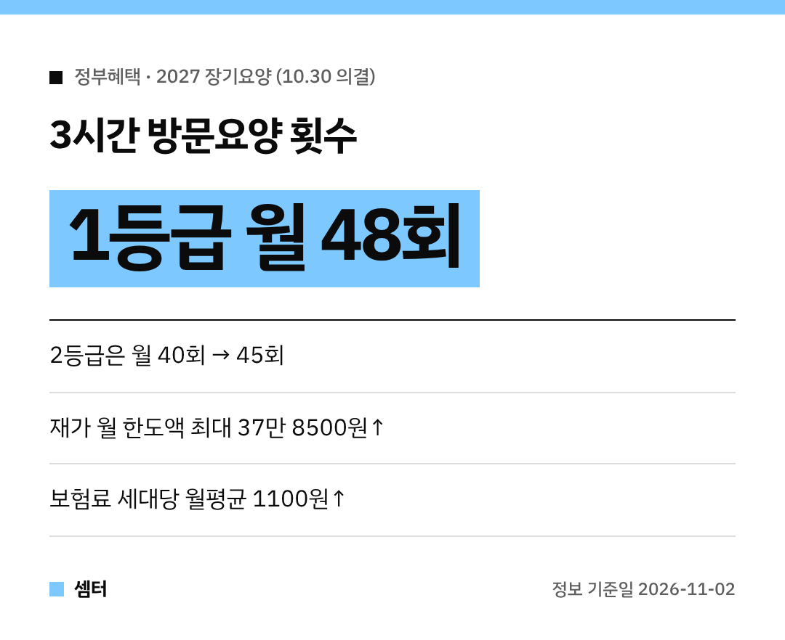

부모님 장기요양 서비스 이용하고 계신 분들, 내년부터 달라지는 게 꽤 있어요~!
보건복지부가 **10월 30일 장기요양위원회**에서 2027년 개선안과 보험료율을 의결했대요 😊

## 집에서 받는 돌봄 한도가 올라요
재가서비스 월 이용 한도액이 등급에 따라 **2만 3880원~37만 8500원** 오른대요.
주야간보호, 단기보호, 방문요양, 방문목욕, 방문간호가 해당돼요.

특히 1·2등급 중증 어르신은 재가 한도액이 시설급여 월 최대 이용료의 100% 수준까지 올라가요.
그래서 **3시간 방문요양** 이용 횟수가 이렇게 늘어나요!

| 등급 | 지금 | 2027년 |
|---|---|---|
| 1등급 | 월 최대 44회 | **월 최대 48회** |
| 2등급 | 월 40회 | **월 45회** |

## 한 곳에서 여러 서비스 받기 쉬워져요
방문요양·방문간호·주야간보호를 한 기관에서 같이 받는 **통합재가서비스** 기관이 늘어나요.
2026년 7월 418곳에서 2027년 **700곳**이 된대요.

방문간호 가산액은 방문당 3000원에서 5000원으로 오르는데요, **어르신 본인부담금은 그대로**래요 👍
재택의료센터도 463곳에서 **500곳**으로 늘어나요.

## 새로 해 보는 서비스
- 재택자립훈련 50곳, 방문영양 20곳으로 시범사업 확대
- 혼자 사시는 어르신·중증 퇴원환자를 위한 **정기순회·수시대응형** 시범사업 (식사·복약·배설 도움, 방문간호 월 1회)
- 병원동행 시범사업 참여기관 확대
- 낙상예방 재가환경지원은 아파트와 일정 조건의 임차주택까지 포함

## 장기요양보험료는 얼마나 올라요?
2027년 장기요양보험료율은 소득 대비 **0.9994%**예요.
올해 0.9448%보다 5.78% 오른 거래요.

세대당 월평균으로 보면 1만 9029원에서 **2만 129원**, 약 **1100원** 늘어나는 셈이에요.
건강보험료에 13.90%를 곱해서 매기는데, 건보료가 월 10만 원이면 장기요양보험료는 1만 3900원이에요.

## 요양보호사분들께도 변화가 있어요
- 종일방문요양 수가에 주휴수당 반영: 17만 7680원 → **20만 6030원**
- 유급휴일 방문요양 가산율 **60%**로 상향
- 2014년 이후 묶여 있던 원거리 교통비 전 구간 **30%** 인상

궁금한 점은 보건복지부 요양보험제도과(044-202-3499)에 물어보시면 돼요.

다들 부모님 돌봄 계획 미리 세워 두시구! 오늘도 좋은 하루 보내세요~ㅎㅎ
