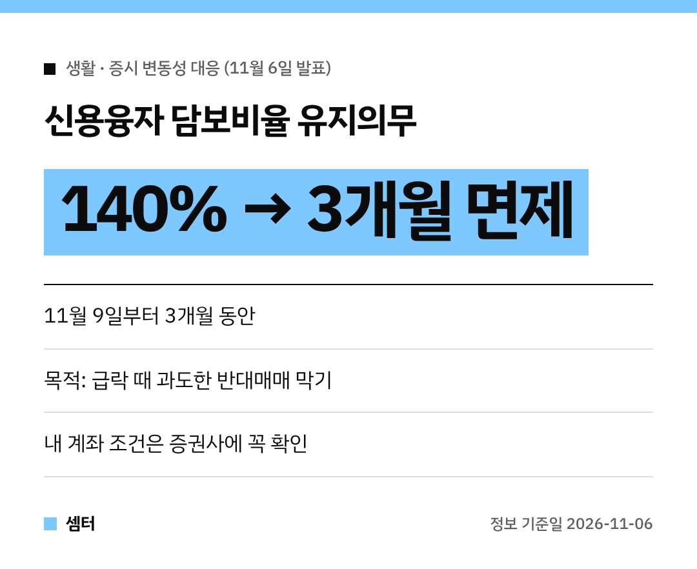

요 며칠 주식 시장 정말 무서웠죠?
신용으로 주식 사신 분들은 반대매매 걱정에 잠도 못 주무셨을 것 같아요~

정부가 11월 6일 대응책을 하나 내놨어요.
**신용융자 담보비율 유지의무를 3개월 면제**한대요!

(투자 권유가 아니라 제도 변화 정리예요 😊)

## 뭐가 바뀌어요?
증권사는 신용융자(돈 빌려서 산 주식)에 대해 **담보비율 140%**를 유지해야 하는 의무가 있었어요.
이 의무를 **11월 9일부터 3개월 동안** 면제해요.

## 왜 하는 거예요?
주가가 확 떨어지면 담보비율이 무너지고, 증권사가 주식을 강제로 파는 **반대매매**가 쏟아져요.
그 매도가 또 주가를 끌어내리는 악순환이 생기죠.

정부는 이런 과도한 반대매매가 시장 변동성을 더 키우는 걸 막으려는 거래요.

## 그럼 반대매매가 아예 없어지나요?
그건 아니에요!
면제되는 건 증권사가 지켜야 하는 **의무**예요.

실제로 내 계좌에서 언제 추가 담보를 요구하고 반대매매를 하는지는 증권사와 맺은 계약 조건에 따라 달라질 수 있어요.
꼭 거래하는 증권사 앱이나 고객센터에서 내 계좌 기준을 확인하세요.

## 정부가 또 뭘 한대요?
11월 6일 부총리 주재로 관계기관 합동 시장상황 점검회의가 열렸어요.
변동성이 더 커지면 추가 안정조치도 내놓겠다고 했답니다.

궁금한 점은 금융위원회 자본시장과(02-2100-2850)에 물어볼 수 있어요.

다들 마음 단단히 붙잡으시구! 오늘도 좋은 하루 보내세요~ㅎㅎ
