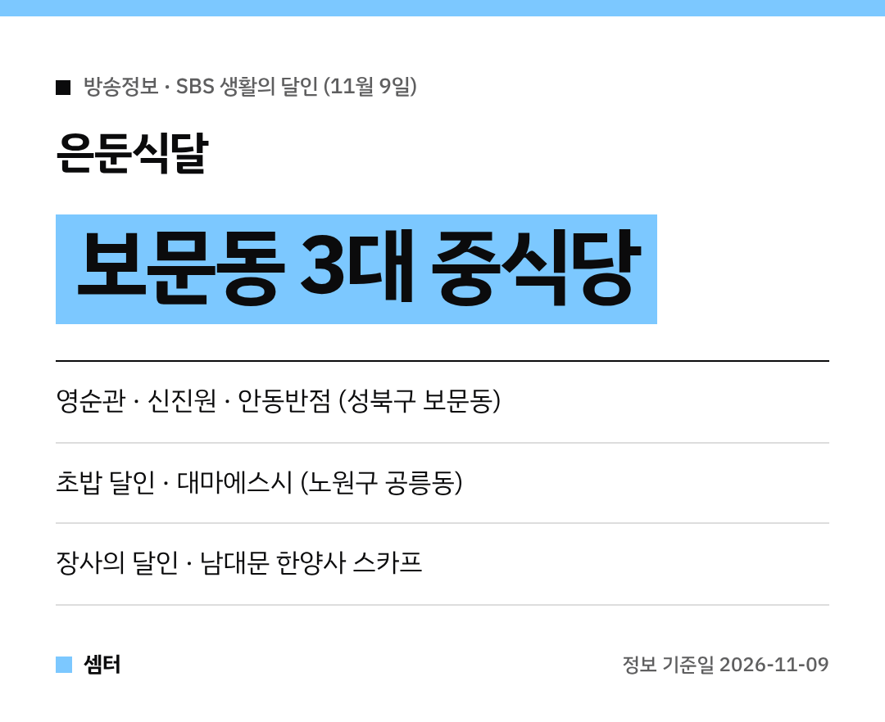

짜장면 한 그릇이 땡기는 날 있잖아요~
11월 9일 '생활의 달인' 은둔식달에 **보문동 중식당 세 곳**이 한꺼번에 나왔어요! 🥢

## 은둔식달: 보문동 3대 중식당
서울 성북구 보문동 골목을 오래 지켜온 중국집 세 곳이에요.
화려한 간판 없이 맛 하나로 단골을 모은 곳들이래요.

짜장면, 짬뽕, 탕수육처럼 대표 메뉴는 집마다 조금씩 달라요.
세 군데 다 돌아보는 '보문동 중식 투어'도 재밌겠죠?

### 영순관
보문동2가에 있어요.

[📍 네이버 지도에서 영순관 보기](https://map.naver.com/p/search/%EB%B3%B4%EB%AC%B8%EB%8F%99%20%EC%98%81%EC%88%9C%EA%B4%80)

### 신진원
보문동5가에 있어요.

[📍 네이버 지도에서 신진원 보기](https://map.naver.com/p/search/%EB%B3%B4%EB%AC%B8%EB%8F%99%20%EC%8B%A0%EC%A7%84%EC%9B%90)

### 안동반점
보문동1가에 있어요.

[📍 네이버 지도에서 안동반점 보기](https://map.naver.com/p/search/%EB%B3%B4%EB%AC%B8%EB%8F%99%20%EC%95%88%EB%8F%99%EB%B0%98%EC%A0%90)

## 초밥 달인: 공릉동 대마에스시
서울 노원구 공릉동의 **대마에스시**도 나왔어요.
반지하에 있는 작은 가게인데, 초밥 솜씨는 대단하대요.

유영학 달인은 **34년 경력**이에요.
대구의 한 호텔 등에서 25년 동안 실력을 쌓았대요.

생선마다 맛이 살아나는 숙성 시점을 찾아서 감칠맛을 낸대요 🍣
점심엔 특선 메뉴도 있어요.

[📍 네이버 지도에서 대마에스시 보기](https://map.naver.com/p/search/%EA%B3%B5%EB%A6%89%EB%8F%99%20%EB%8C%80%EB%A7%88%EC%97%90%EC%8A%A4%EC%8B%9C)

## 장사의 달인: 남대문 스카프 아저씨
"돈 쓰지 마~" 하면서 손님을 말리는데도 사람이 몰리는 가게예요.
남대문 **한양사**의 스카프는 **6개에 1만 원**이래요.

[📍 네이버 지도에서 한양사 보기](https://map.naver.com/p/search/%EB%82%A8%EB%8C%80%EB%AC%B8%20%ED%95%9C%EC%96%91%EC%82%AC)

## 가기 전에
방송 다음 날은 노포 중식당 앞에 줄이 길어질 수 있어요.
쉬는 날과 영업시간은 지도에서 꼭 확인하고 가세요~

다들 맛있는 한 끼 하시구! 오늘도 좋은 하루 보내세요~ㅎㅎ
