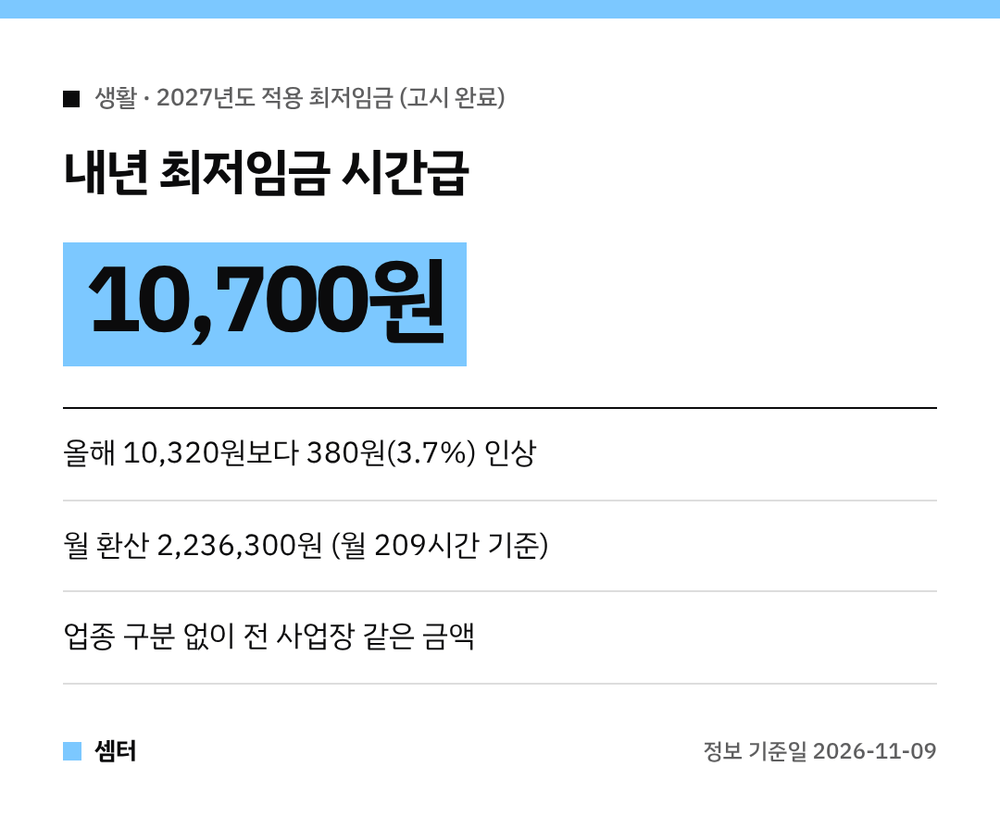

연말 다가오니까 내년 월급 계산해 보시는 분들 많으시죠~
알바하시는 분도, 사장님도 꼭 알아야 하는 **2027년 최저임금** 정리해 봤어요!

결론부터 말하면 **시간급 10,700원**이에요.
이미 고시까지 끝나서 확정된 금액이랍니다 😊

## 얼마나 올랐어요?
올해 최저임금은 시간급 10,320원이었어요.
내년엔 **380원 오른 10,700원**, 인상률로는 **3.7%**예요.

## 월급으로 바꾸면?
한 주에 40시간 일하는 기준으로 **월 209시간**을 잡아요.
이렇게 계산한 월 환산액은 **2,236,300원**이에요.

월급 받는 분들은 내 기본급이 이 금액보다 낮지 않은지 한 번 확인해 보세요~ 💪

## 누구에게 적용돼요?
업종에 따라 다르게 정하지 않았어요.
**모든 사업장에 똑같은 금액**이 적용된답니다.

도급제로 일하는 분들도 마찬가지예요.

## 어떻게 정해졌어요?
최저임금위원회가 7월 14일 제14차 전원회의에서 결정했어요.
마지막에 근로자위원은 10,730원, 사용자위원은 10,700원을 냈고, 투표로 사용자위원 안이 의결됐대요.

이후 고용노동부가 7월 16일 최저임금안을 고시하고 이의제기 기간을 거쳤어요.
민주노총과 소상공인연합회가 이의를 냈지만 받아들여지지 않았고, **8월 5일 최종 고시**됐답니다.

## 영향받는 사람은 얼마나?
고용형태별 근로실태조사 기준으로 약 **66만 명**이 영향을 받는 것으로 추정됐어요.
경제활동인구 부가조사 기준으로는 297만 8000명이래요.

## 체크해 둘 것
- 알바 계약서 쓸 때 내년 시급이 10,700원 이상인지 확인
- 월급제라면 월 209시간 기준 2,236,300원과 비교
- 고용노동부는 내년 최저임금이 지켜지도록 사업장 지도·감독도 하겠다고 했어요

다들 땀 흘린 만큼 꼭 챙겨 받으시구! 오늘도 좋은 하루 보내세요~ㅎㅎ
