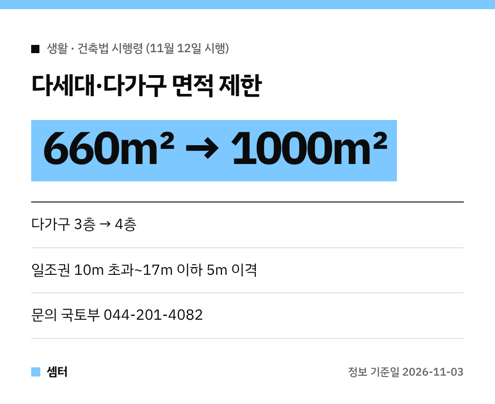

빌라나 다가구 짓거나 재건축 고민하시는 분들, 큰 변화가 생겼어요~!
**30년 넘게** 묶여 있던 다세대·다가구 규제가 **11월 12일부터** 풀린대요 🏠

## 언제부터예요?
11월 3일 국무회의에서 건축법 시행령 개정안이 의결됐고, **11월 12일부터 시행**돼요.
8월 13일 발표한 '주택 신속공급 방안'에 담겼던 내용이에요.

## 무엇이 달라져요?
| 항목 | 지금 | 11월 12일부터 |
|---|---|---|
| 다세대·다가구 면적 제한 | 660㎡ | **1000㎡** (약 51.5%↑) |
| 다가구 층수 | 3층 이하 | **4층 이하** |

용적률 같은 다른 기준을 맞춰도 면적·층수 제한 때문에 건물을 크게 못 짓는 경우가 많았는데요.
이제 중·대규모 땅에서도 더 크게 지을 수 있게 된 거예요.

## 주민공동시설은 용적률 완화
다세대주택에 주민공동시설을 넣으면, 건축위원회를 거쳐 **용적률을 완화**받을 수 있게 돼요.
원룸·투룸 일색에서 벗어나 다양한 구조의 집이 나올 거라는 기대도 있대요.

## 일조권 기준도 바뀌어요
지금은 건물 높이가 10m를 넘으면 위층이 사선으로 꺾여서 모양도 어색하고 안쪽 공간도 좁아졌죠.
11월 12일부터는 **10m 초과~17m 이하 구간에 5m 고정 이격** 기준이 적용돼요 👍

## 문의
국토교통부 건축정책과(044-201-4082)로 물어보시면 돼요.
실제 설계·인허가는 꼭 건축사와 해당 지자체에 확인하세요!

다들 좋은 집 지으시구! 오늘도 좋은 하루 보내세요~ㅎㅎ
