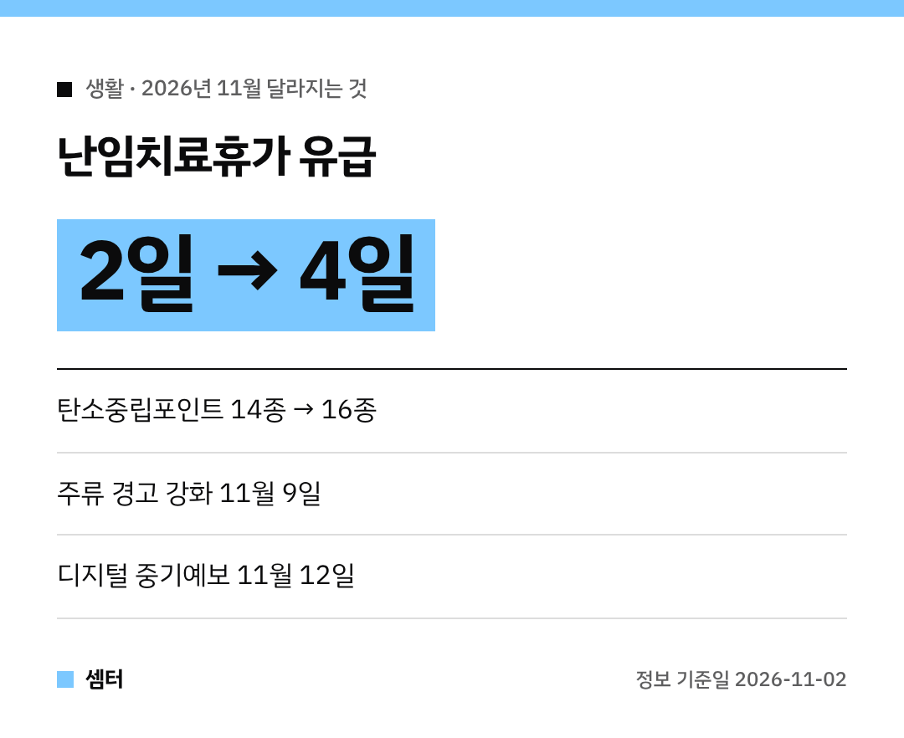

벌써 11월이에요~!
이번 달부터 바뀌는 생활 정책이 꽤 있어서, 내 생활에 닿는 것만 골라 정리해 봤어요 😊

## 난임치료휴가, 유급이 4일로
난임치료휴가는 1년에 최대 6일 쓸 수 있는 법정휴가예요.
이 중 **유급 기간이 2일에서 4일로** 늘어나요!

정부가 우선지원대상기업 근로자에게 주는 급여 지원도 **11월 27일부터** 4일로 늘어난대요.
휴가 시작일 기준 통상임금을 받는데, 상한액은 **33만 6840원**이에요.

급여는 휴가 시작 1개월 뒤부터, 끝난 날로부터 12개월 안에 청구하면 돼요.
기한 놓치지 않게 꼭 메모해 두세요~

## 술병·주류 광고 경고가 더 커져요
**11월 9일부터** 주류 용기와 광고의 경고 문구·그림이 강화돼요.
과음과 음주운전 위험을 알리는 문구와 그림이 추가되고, 글씨도 커진대요.

연말 모임 많아지는 때라 타이밍이 딱이네요!

## 전기·수소택시 타도 포인트 적립
탄소중립포인트 항목이 **14종에서 16종**으로 늘어나요.
새로 들어간 건 **무탄소(전기·수소) 택시 이용**이랑 **다회용 택배상자 사용**이에요.

택시 앱에서 전기·수소 택시를 따로 골라 타면 된대요.
1년에 최대 **7만 원**까지 받을 수 있어요 👍

## 날씨 앱 중기예보가 촘촘해져요
기상청이 **11월 12일부터** 디지털 중기예보를 전면 시행해요.

- 비가 "온다/안 온다" 대신 **강수 가능성**으로 알려 줘요
- 시·도 단위에서 **5km 격자** 단위로 더 자세해져요
- 6~8일 뒤는 **3시간 단위**, 9~11일 뒤는 **6시간 단위**

날씨누리나 날씨알리미 앱에서 '특보-예보' → '중기예보'로 들어가면 볼 수 있어요.

## 가짜 상품 의심되면 사진으로 감정 신청
온라인에서 산 물건이 위조품 같다면, 이제 **제품 사진만 올려서** 감정을 신청할 수 있게 돼요.
AI 감정 보고서를 바탕으로 상표권자가 의견을 내고, 플랫폼이 환불·유통차단을 하는 구조래요.

## 그 밖에
- 일본 **난카이 해곡**(경도 136도까지)도 국외지진 조기경보 서비스 지역에 들어가요
- 공동주택·학교·어린이집에서 쓰레기 수거 차량에 후방영상장치 같은 안전기준이 강화돼요

다들 이번 달 바뀌는 것 잘 챙기시구! 오늘도 좋은 하루 보내세요~ㅎㅎ
