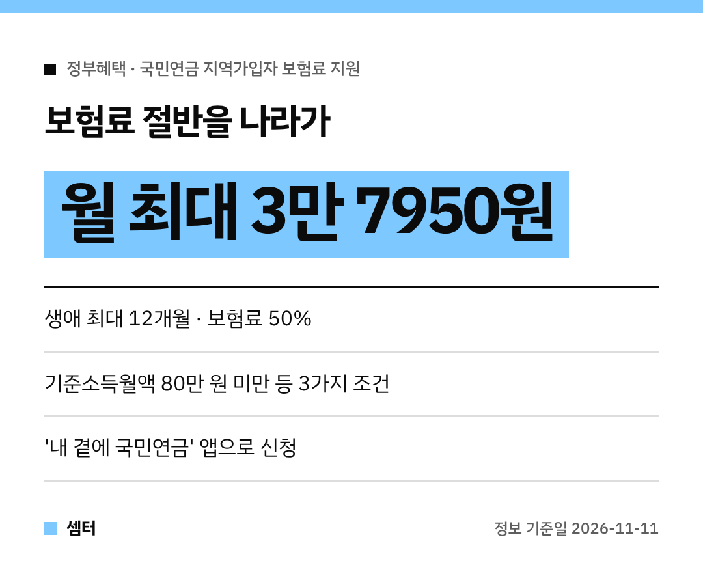

프리랜서, 1인 사장님들 국민연금 보험료 내기 빠듯하시죠~
그런데 **보험료 절반을 나라가 지원**해 주는 제도가 있다는 거 아셨어요? 😊

저소득 **지역가입자**라면 꼭 확인해 보세요!

## 어떤 제도예요?
저소득 지역가입자의 부담을 덜고 노후 준비를 이어가도록 **연금보험료의 50%**를 지원해 줘요.
**생애 최대 12개월**까지, **월 최대 3만 7950원**이에요.

## 올해 달라진 점
**올해부터 납부 재개 요건이 없어졌어요.**
그래서 소득 기준만 맞으면, 꾸준히 보험료를 내 오던 분도 신청할 수 있어요!

## 누가 받을 수 있어요?
국민연금 지역가입자 중 아래 **세 가지를 모두** 충족해야 해요.

- 기준소득월액 **80만 원 미만**
- 재산세 과세표준 합계 **6억 원 미만**
- 사업·근로소득을 뺀 종합소득 **연 1680만 원 미만**

실업크레딧이나 농어업인 연금보험료 지원을 받고 있다면 **중복 지원은 안 돼요.**

## 어떻게 신청해요?
지사 방문이나 전화 말고도, **올해 6월부터** 모바일 앱 **'내 곁에 국민연금'**과 공단 누리집에서 신청할 수 있어요.
바쁜 사장님들도 휴대폰으로 간단히 할 수 있겠죠?

## 받아 본 사람들 반응은?
보건복지부와 국민연금공단이 응답자 1816명을 분석했더니, 지원 덕분에 고정 지출 부담이 줄고 노후 준비를 이어갈 수 있다는 안도감이 생겼다는 답이 많았대요.

조건 맞으시는 분들은 꼭 신청해서 노후 준비 이어가시구! 오늘도 좋은 하루 보내세요~ㅎㅎ
