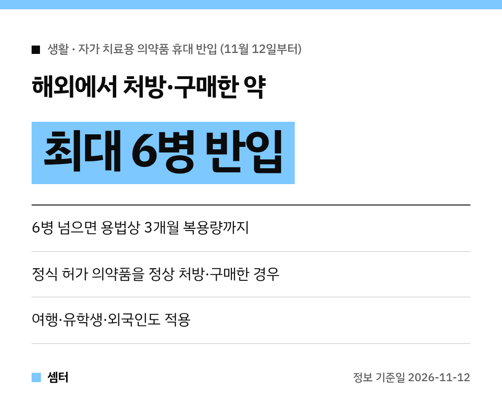

해외여행 다녀오면서 현지에서 산 약 때문에 세관에서 마음 졸이신 적 있으시죠~
이제 그런 걱정이 확 줄어요! 💊

**11월 12일부터** 정상적으로 처방받거나 산 약은 **최대 6병까지** 들고 들어올 수 있대요.

## 뭐가 바뀌었어요?
그동안은 제대로 처방받은 약인데도 입국할 때 세관에서 **통관이 보류**되는 일이 있었어요.
불편하다는 목소리가 계속 나와서 식약처와 관세청이 기준을 바꿨대요.

## 얼마나 가져올 수 있어요?
- 자가 치료용 의약품 **최대 6병**
- 6병이 넘으면 **용법상 3개월 복용량**까지

## 예를 들면?
일주일에 한 번, 1개씩 스스로 주사하는 **GLP-1 계열 비만치료제**라면요.
3개월 복용량인 **12개까지** 들고 올 수 있대요.

## 어떤 약이어야 해요?
그 나라 정식 의료체계에서 **의약품 규제기관의 정식 허가를 받은 약**을 정상적으로 처방·구매한 경우예요.
출처가 불분명한 약은 해당되지 않으니 주의하세요!

## 누구한테 적용돼요?
- 국내에서 먹던 약을 들고 출국했다가 다시 들어올 때
- 해외여행 중에 정상적으로 처방·구매한 약을 가져올 때
- 외국인·유학생이 해외에서 먹던 약을 가져올 때

모두 적용된대요 😊

## 궁금하면 여기로
- 식약처 의약품관리과 043-719-2652
- 관세청 관세국경감시과 042-481-7831

다들 건강하게 여행 다녀오시구! 오늘도 좋은 하루 보내세요~ㅎㅎ
