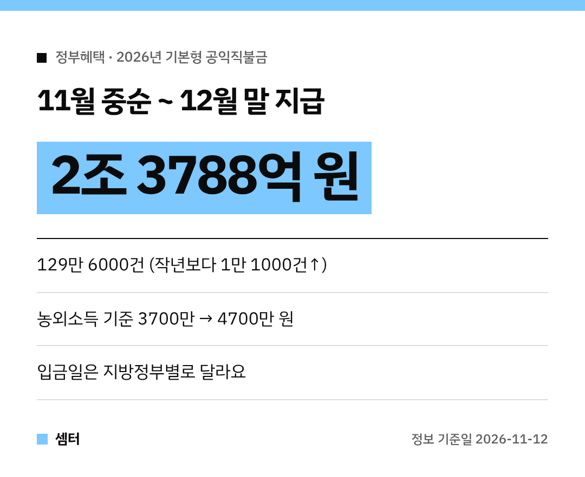

농사지으시는 부모님 계신 분들, 이 소식 꼭 전해 드리세요~
**2026년 공익직불금**이 **11월 중순부터** 들어온대요! 🌾

## 얼마나 지급돼요?
총 **2조 3788억 원**이에요.
지급대상은 농가·농업인·농업법인 등 **129만 6000건**으로, 작년보다 1만 1000건 늘었어요.

- **소농직불금**: 54만 4000농가, 7061억 원
- **면적직불금**: 75만 2000건, 1조 6727억 원

## 언제 들어와요?
농식품부가 **13일까지** 지방정부에 돈을 내려보내요.
그다음 지방정부가 대상자와 계좌를 확인해서 **11월 중순부터 12월 말까지** 지급해요.

실제 입금일은 **지방정부마다 달라요**.
궁금하면 사는 지역 읍·면사무소에 확인해 보세요!

## 올해 달라진 점: 농외소득 기준 완화
직불금을 못 받게 하는 **농업 외 종합소득 기준**이 **3700만 원에서 4700만 원**으로 올라갔어요.
**17년 만의 상향**이래요.

올해 면적직불금 등록신청자부터 적용돼요.
그래서 더 많은 농업인이 받을 수 있게 됐어요 😊

## 빠지거나 깎인 경우도
신청 133만 2000건을 검증해서 약 **3만 6000건**은 대상에서 빠졌어요.
농지 관리·농약 안전사용·교육 이수 같은 **16개 준수사항**을 어긴 1만 7255건은 약 32억 원이 감액됐대요.

## 문의
농림축산식품부 농촌소득정책과 044-201-2821

다들 한 해 농사 수고 많으셨구! 오늘도 좋은 하루 보내세요~ㅎㅎ
