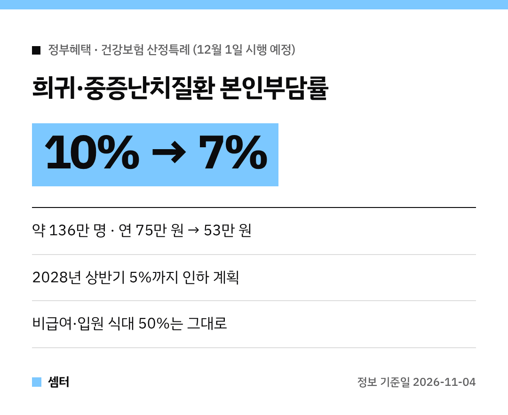

희귀질환이나 중증난치질환으로 오래 치료받는 가족이 있다면 꼭 보셔야 할 소식이에요.
병원비 본인부담이 **12월부터 줄어들 예정**이래요 😊

## 무엇이 바뀌어요?
희귀·중증난치질환자의 건강보험 **급여 진료비** 본인부담률이 **10%에서 7%**로 낮아져요.
시행은 **12월 1일** 예정이에요!

지금은 산정특례로 10%를 냈는데, 암이나 심뇌혈관질환 같은 다른 중증질환(5%)보다 높았거든요.

## 얼마나 줄어요?
약 **136만 명**이 해당되고요.
1인당 연평균 본인부담액이 약 **75만 원에서 53만 원**으로 줄 것으로 예상된대요.

## 앞으로 더 낮아져요
이번이 첫 단계예요.
**2028년 상반기에는 5%**까지 내릴 계획이래요(계획 단계예요).

## 그대로인 것도 있어요
- 비급여 진료비
- 입원 중 식대 본인부담률 50%

이 부분은 지금과 같아요.

## 아직 확정 전이에요
보건복지부가 '국민건강보험법 시행령' 개정안을 **11월 16일까지 입법예고** 중이에요.
의견 수렴, 법제처 심사, 국무회의를 거쳐 12월 1일에 시행할 계획이에요.

궁금한 점은 보건복지부 보험정책과(044-202-2702)로 물어보시면 돼요.

다들 건강 잘 챙기시구! 오늘도 좋은 하루 보내세요~ㅎㅎ
