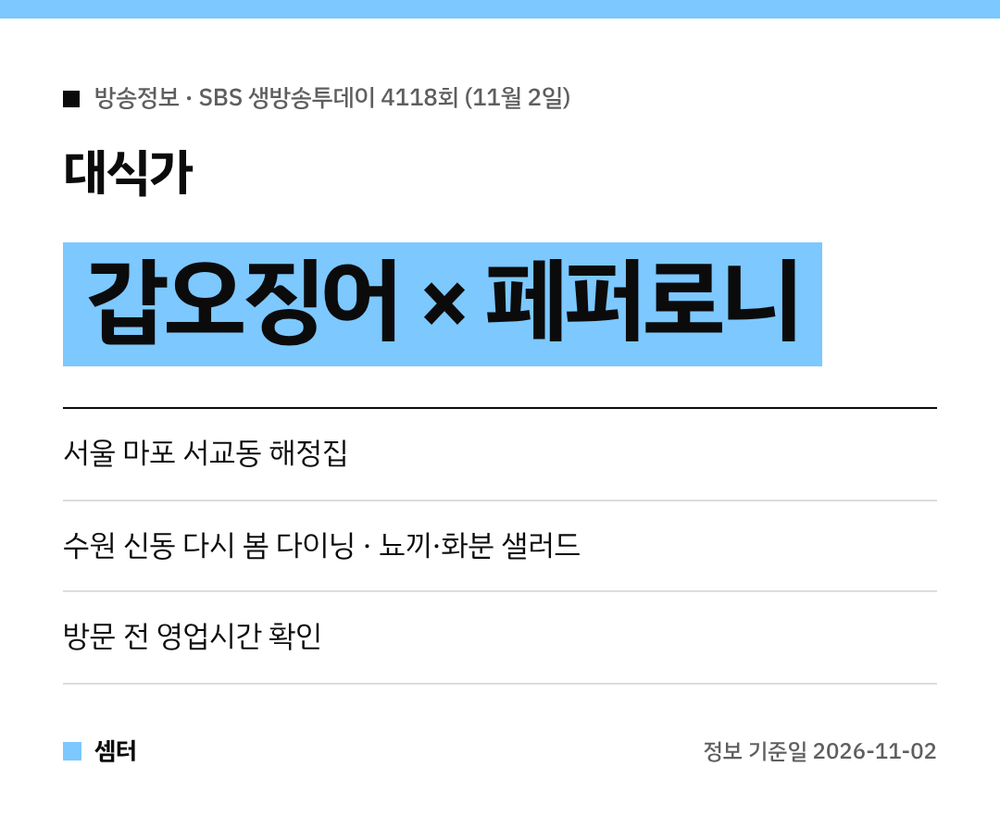

익숙한 재료에 반전 한 스푼, 오늘 생방송투데이 '대식가'는 이색 메뉴 특집이었어요~!
11월 2일 4118회에 나온 두 집을 정리해 봤어요 😋

## 서울 마포 해정집: 페퍼로니 갑오징어볶음
합정역과 상수역 사이, 마포구 서교동에 있는 **해정집**이에요.
쫄깃한 갑오징어에 페퍼로니를 더한 **페퍼로니 갑오징어볶음**이 주인공이었어요.

피자 재료가 볶음에 들어간다니, 상상만 해도 궁금하죠?
뚝배기 불스지, 순대곱창볶음, 뼈해장국 같은 메뉴도 있대요.

[📍 네이버 지도에서 해정집 보기](https://map.naver.com/p/search/%EB%A7%88%ED%8F%AC%20%ED%95%B4%EC%A0%95%EC%A7%91)

## 수원 다시 봄 다이닝: 뇨끼와 화분 샐러드
수원 영통구 신동, 신동카페거리 쪽에 있는 양식집 **다시 봄 다이닝**이에요.
매콤하게 변신한 **뇨끼**랑 화분처럼 생긴 **화분 샐러드**가 소개됐어요 🌱

잠봉 매운 크림 뇨끼, 트러플 크림 뇨끼, 꽃게 로제 파스타, 잠봉 옥수수 치즈 듬뿍 피자도 판대요.
데이트나 기념일에 가기 좋아 보여요!

[📍 네이버 지도에서 다시 봄 다이닝 보기](https://map.naver.com/p/search/%EC%88%98%EC%9B%90%20%EB%8B%A4%EC%8B%9C%EB%B4%84%EB%8B%A4%EC%9D%B4%EB%8B%9D)

## 가기 전에 체크
방송 뒤엔 손님이 확 몰릴 수 있어요.
영업시간이랑 쉬는 날은 지도 앱에서 출발 전에 꼭 확인해 보세요~

## 오늘 다른 코너
2AM 이창민이 트로트에 도전하는 '오늘은 못 참지 엔터'도 함께 방송됐어요.

다들 맛있는 저녁 드시구! 오늘도 좋은 하루 보내세요~ㅎㅎ
