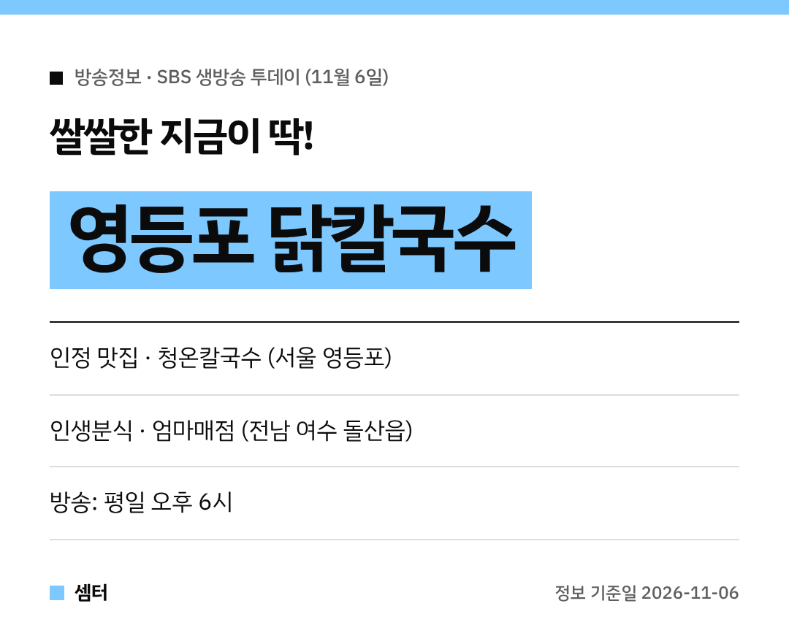

찬 바람 불면 뜨끈한 국물 생각 절로 나죠~
11월 6일 SBS '생방송 투데이'에 딱 그런 메뉴가 나왔어요 🍜

## 인정 맛집: 영등포 청온칼국수
'쌀쌀한 지금이 딱!' 편 주인공은 서울 영등포의 **청온칼국수**예요.
메뉴는 따끈한 **닭칼국수**랍니다.

면을 직접 반죽해서 닭 육수에 끓여 낸대요.
닭한마리도 대표 메뉴라 여럿이 가서 나눠 먹기도 좋아요!

[📍 네이버 지도에서 청온칼국수 보기](https://map.naver.com/p/search/%EC%98%81%EB%93%B1%ED%8F%AC%20%EC%B2%AD%EC%98%A8%EC%B9%BC%EA%B5%AD%EC%88%98)

## 인생분식: 여수 엄마매점
'인생분식 – 내 곁에 행복을 말하다' 코너는 전남 여수로 갔어요.
돌산읍에 있는 **엄마매점**이에요.

오랜 정이 담긴 작은 매점 이야기가 소개됐어요 😊

[📍 네이버 지도에서 엄마매점 보기](https://map.naver.com/p/search/%EC%97%AC%EC%88%98%20%EB%8F%8C%EC%82%B0%20%EC%97%84%EB%A7%88%EB%A7%A4%EC%A0%90)

## 가기 전에
방송 나간 다음 날은 손님이 몰릴 수 있어요.
영업시간이랑 쉬는 날은 지도에서 한 번 확인하고 출발하세요~

다들 따뜻한 한 그릇 드시구! 오늘도 좋은 하루 보내세요~ㅎㅎ
