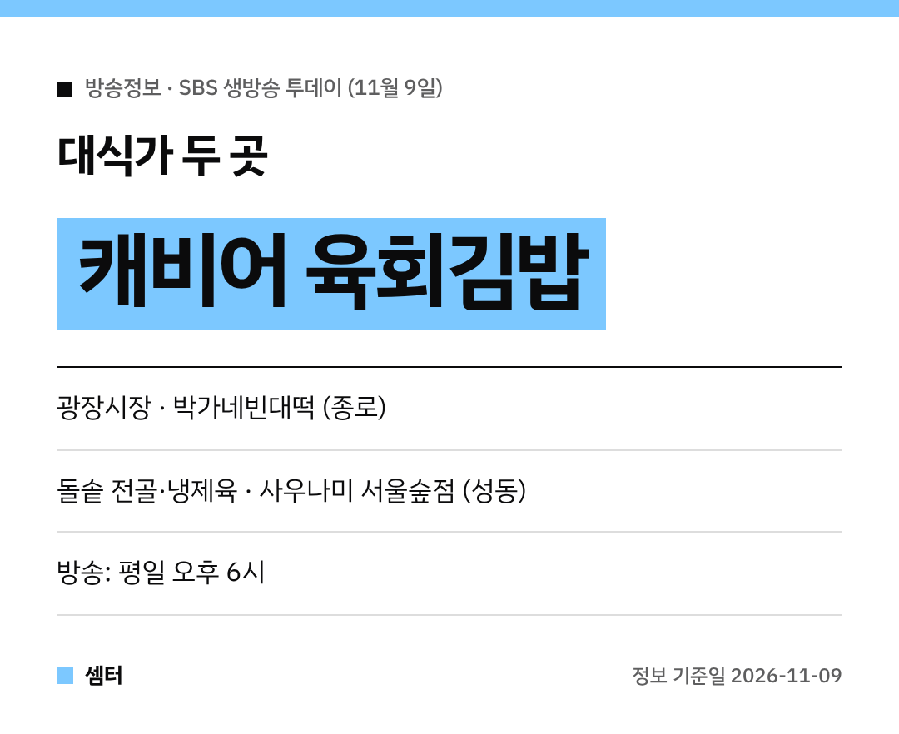

김밥 위에 캐비어라니, 상상만 해도 궁금하지 않으세요~?
11월 9일 SBS '생방송 투데이' 대식가 코너에 이색 메뉴가 두 군데 나왔어요! 😋

## 대식가①: 광장시장 박가네빈대떡
'외국인을 사로잡은 김밥' 편은 서울 종로 **광장시장**으로 갔어요.
주인공은 **캐비어 육회김밥**과 **트러플 육회**예요.

부드러운 육회에 톡톡 터지는 캐비어를 올린 김밥이래요.
나온 곳은 광장시장 안 **박가네빈대떡**이에요.

빈대떡·전·육회로 원래 유명한 집이라 같이 시켜 먹기 좋아요!
[📍 네이버 지도에서 박가네빈대떡 보기](https://map.naver.com/p/search/%EA%B4%91%EC%9E%A5%EC%8B%9C%EC%9E%A5%20%EB%B0%95%EA%B0%80%EB%84%A4%EB%B9%88%EB%8C%80%EB%96%A1)

## 대식가②: 서울숲 사우나미
두 번째는 서울 성동구로 갔어요.
약 **300℃**까지 달군 돌솥에 끓여 나오는 전골, 그리고 **24시간 숙성 냉제육**이 나왔어요.

나온 곳은 솥면 전문점 **사우나미 서울숲점**이에요.
뜨거운 국물과 차가운 냉제육을 한 번에 즐길 수 있대요 🔥

[📍 네이버 지도에서 사우나미 서울숲점 보기](https://map.naver.com/p/search/%EC%82%AC%EC%9A%B0%EB%82%98%EB%AF%B8%20%EC%84%9C%EC%9A%B8%EC%88%B2%EC%A0%90)

## 가기 전에
광장시장은 주말에 사람이 많이 몰려요.
방송 다음 날도 붐빌 수 있으니 영업시간은 지도에서 확인하고 가세요~

다들 맛있는 저녁 드시구! 오늘도 좋은 하루 보내세요~ㅎㅎ
