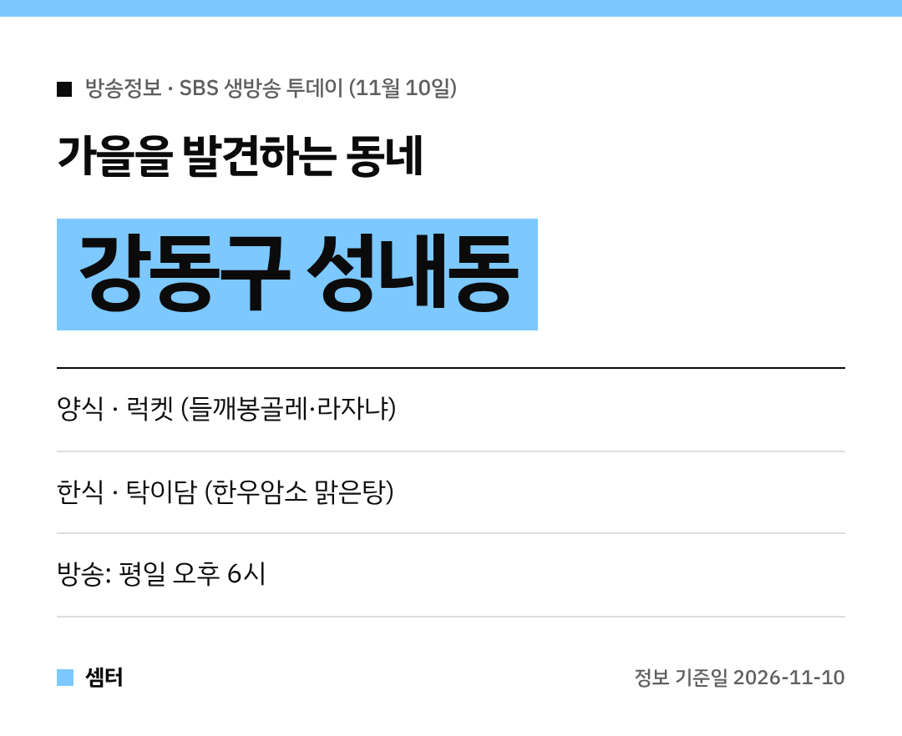

가을 데이트 코스 찾는 분들 주목~
11월 10일 '생방송 투데이' UDT 코너가 **서울 강동구 성내동**으로 갔어요! 🍂

## 양식: 럭켓
첫 번째는 강동구청역 근처 캐주얼 다이닝 **럭켓**이에요.
**들깨 봉골레 오르끼에떼**, 라자냐, 트러플 누룽지 리조또가 나왔어요.

들깨를 넣은 봉골레라니 궁금하죠?
제철 재료로 숯·수비드·훈연 같은 조리법을 쓰는 곳이래요.

와인이나 위스키도 곁들일 수 있어서 데이트 장소로도 좋아요!

[📍 네이버 지도에서 럭켓 보기](https://map.naver.com/p/search/%EC%84%B1%EB%82%B4%EB%8F%99%20%EB%9F%AD%EC%BC%93)

## 한식: 탁이담
두 번째는 성내전통시장 쪽 한식집 **탁이담**이에요.
**한우암소 맑은탕**, 한우 고사리 육개장, 한우암소 수육 알배추찜이 나왔어요.

부드러운 한우로 끓인 깊은 국물이 이 집 자랑이래요 😋

[📍 네이버 지도에서 탁이담 보기](https://map.naver.com/p/search/%EC%84%B1%EB%82%B4%EB%8F%99%20%ED%83%81%EC%9D%B4%EB%8B%B4)

## 가기 전에
방송 다음 날은 손님이 몰릴 수 있어요.
쉬는 날과 영업시간은 지도에서 꼭 확인하세요~

다들 맛있는 가을 보내시구! 오늘도 좋은 하루 보내세요~ㅎㅎ
