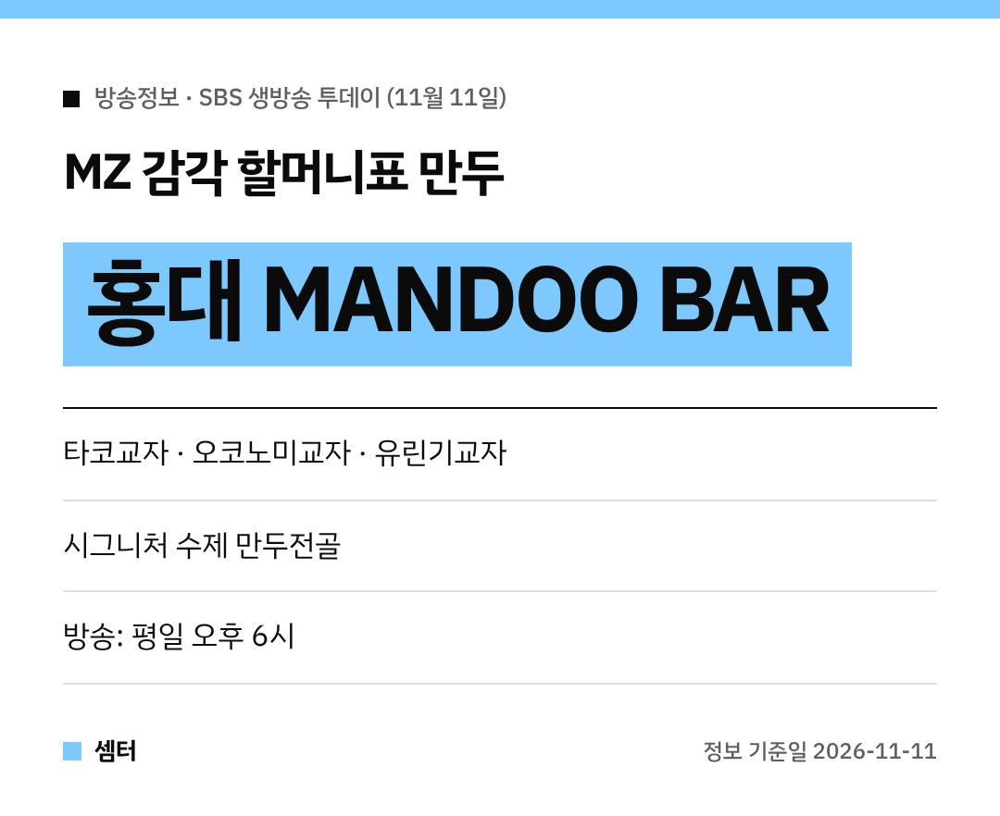

만두 좋아하시는 분들 모이세요~
11월 11일 '생방송 투데이'에 아주 **이색적인 만두집**이 나왔어요! 🥟

## 이유 있는 맛플리: 홍대 MANDOO BAR
서울 마포구 홍대의 **MANDOO BAR**예요.
익숙한 할머니표 만두를 젊은 감각으로 바꿔 낸 곳이래요.

## 어떤 메뉴가 있어요?
- **멕시칸 타코교자**, 과카몰리를 곁들인 교자
- 가쓰오부시 듬뿍 **오코노미교자**
- **유린기교자**, 달달한 슈프림양념교자, 뿌링교자
- 만두·버섯·유부·게살완탕이 들어간 **시그니처 수제 만두전골**

교자 위에 토핑을 푸짐하게 올려서 비주얼부터 독특하대요 😋

## 지도
방송 다음 날은 손님이 몰릴 수 있으니 영업시간은 지도에서 꼭 확인하세요!

[📍 네이버 지도에서 MANDOO BAR 보기](https://map.naver.com/p/search/%ED%99%8D%EB%8C%80%20%EB%A7%8C%EB%91%90%EB%B0%94)

다들 맛있는 만두 드시구! 오늘도 좋은 하루 보내세요~ㅎㅎ
