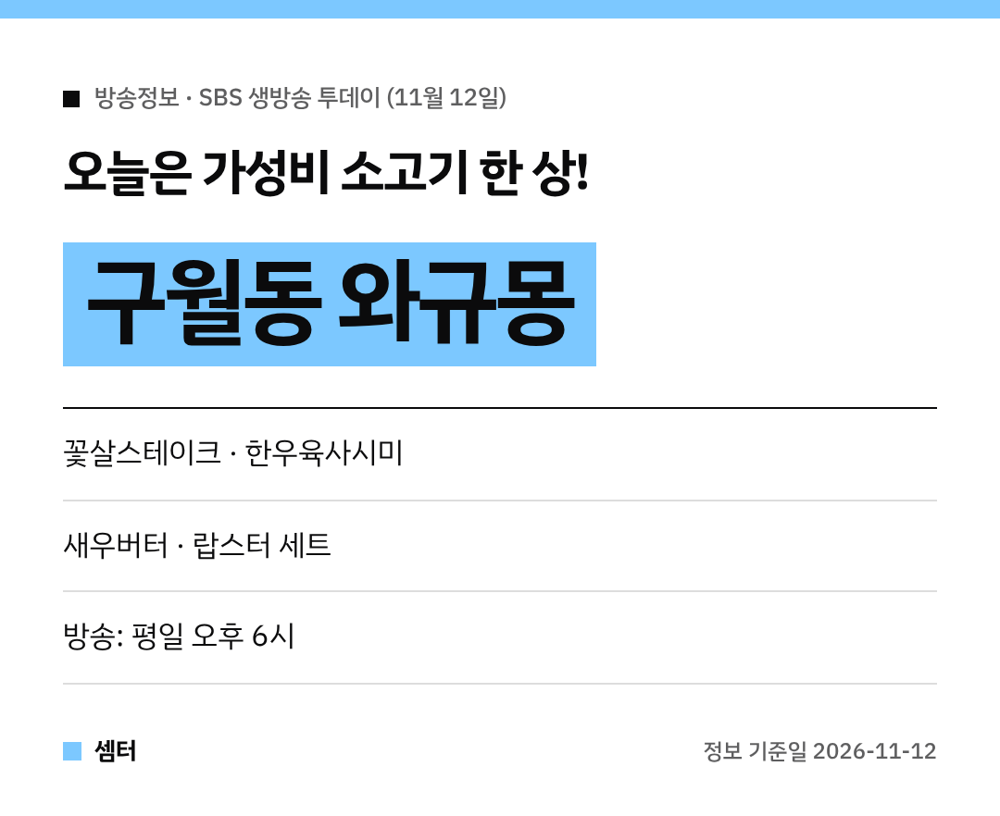

퇴근길에 소고기 한 상 어떠세요~?
11월 12일 '생방송 투데이' 맛있는 퇴근에 **가성비 소고기 한 상**이 나왔어요! 🥩

## 맛있는 퇴근: 인천 구월동 와규몽
인천 남동구 구월동의 **와규몽**이에요.
인천터미널역 근처, 구월동 로데오거리 쪽 소고기 전문점이래요.

와규와 한우를 중심으로 스테이크·육회·육사시미까지 다양하게 낸대요.

## 어떤 메뉴가 있어요?
- **꽃살**, **꽃살스테이크**
- **한우육사시미**, 한우육회, 한우타다끼
- 새우버터세트, **랍스터세트**

고기에 랍스터·새우까지 곁들일 수 있어서 데이트나 회식 자리로도 좋대요 😋

[📍 네이버 지도에서 와규몽 보기](https://map.naver.com/p/search/%EA%B5%AC%EC%9B%94%EB%8F%99%20%EC%99%80%EA%B7%9C%EB%AA%BD)

## 가기 전에
방송 다음 날은 손님이 몰릴 수 있어요.
영업시간과 브레이크타임은 지도에서 꼭 확인하세요~

다들 맛있는 퇴근길 되시구! 오늘도 좋은 하루 보내세요~ㅎㅎ
