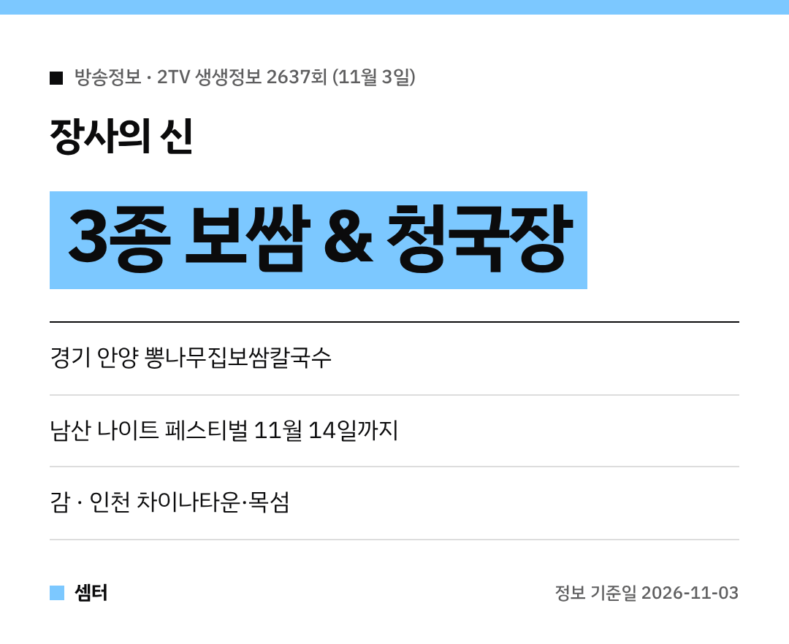

쌀쌀한 저녁엔 보쌈에 구수한 청국장 한 그릇 어떠세요~?
오늘(11월 3일) 저녁 6시 35분 '2TV 생생정보' 2637회에 딱 그 조합이 나온대요 😋

## 장사의 신: 3종 보쌈 & 청국장 세트
경기 안양시 만안구, 관악역 근처에 있는 **뽕나무집보쌈칼국수**예요.
세 가지 보쌈과 청국장을 한 상에 내는 정식이 주인공이에요!

보쌈·칼국수·만두전골 같은 한식에, **꾸지뽕**을 활용한 요리를 내는 곳이래요.
보쌈이랑 칼국수를 같이 먹는 정식도 있어요.

[📍 네이버 지도에서 뽕나무집보쌈칼국수 보기](https://map.naver.com/p/search/%EC%95%88%EC%96%91%20%EB%BD%95%EB%82%98%EB%AC%B4%EC%A7%91%EB%B3%B4%EC%8C%88%EC%B9%BC%EA%B5%AD%EC%88%98)

방송 뒤엔 손님이 몰릴 수 있으니, 영업시간과 대기 상황은 미리 확인하세요!

## 생생 현장: 2026 남산 나이트 페스티벌
남산공원 **백범광장**을 중심으로 열리는 가을밤 축제예요.
**10월 23일부터 11월 14일까지**라서 아직 갈 수 있어요 🌙

잔디광장에서 야경 보며 즐기는 '남산 캠프닉'이 대표 프로그램이래요.

[📍 네이버 지도에서 남산공원 백범광장 보기](https://map.naver.com/p/search/%EB%82%A8%EC%82%B0%EA%B3%B5%EC%9B%90%20%EB%B0%B1%EB%B2%94%EA%B4%91%EC%9E%A5)

## 음식 X-파일: 달콤한 가을의 선물, 감
충북 영동과 전남 담양을 찾아 감이 열리고 수확되는 과정, 곶감처럼 다양하게 쓰이는 모습을 보여 준대요.

## 미스터 Lee의 사진 한 컷: 인천
490번째 미션은 인천이에요.
차이나타운에서 시작해 섬과 바다가 있는 옹진군 쪽, 선재2리마을과 목섬까지 둘러본대요.

## 힘쓰니까 청춘이다
충남 아산에서 버려진 물건 속 가치를 찾는 고물상 청춘을 만나요.

다들 든든한 저녁 드시구! 오늘도 좋은 하루 보내세요~ㅎㅎ
