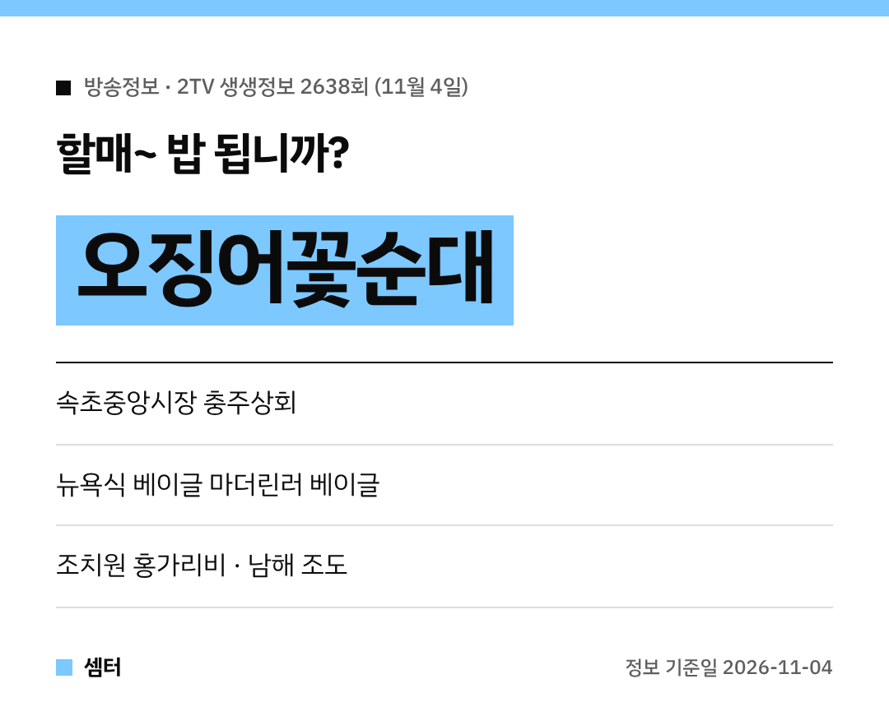

쌀쌀한 날엔 쫄깃한 오징어순대 한 접시 생각나지 않으세요~?
오늘(11월 4일) 저녁 6시 35분 '2TV 생생정보' 2638회에 속초 오징어꽃순대가 나온대요 🦑

## 할매~ 밥 됩니까?: 속초 충주상회
속초 금호동, **속초중앙시장** 쪽에 있는 **충주상회**예요.
명순 할매의 **오징어꽃순대**가 주인공이에요!

아바이순대, 막창순대, 누룽지순대 같은 순대 메뉴도 여러 가지래요.
속초 여행 가면 시장 구경하면서 들르기 좋겠어요.

[📍 네이버 지도에서 충주상회 보기](https://map.naver.com/p/search/%EC%86%8D%EC%B4%88%20%EC%B6%A9%EC%A3%BC%EC%83%81%ED%9A%8C)

## 독한 인생: 뉴욕식 베이글 마더린러 베이글
사업 실패를 딛고 뉴욕식 베이글로 다시 일어선 이야기예요.
서울 서대문구 **마더린러 베이글**과 부산 **해운대점**이 나와요 🥯

[📍 네이버 지도에서 마더린러 베이글 보기](https://map.naver.com/p/search/%EB%A7%88%EB%8D%94%EB%A6%B0%EB%9F%AC%20%EB%B2%A0%EC%9D%B4%EA%B8%80)

## 지금이 딱~ 제철!: 홍가리비
가을 바다의 단풍이라 불리는 **홍가리비**를 소개해요.
세종시 조치원읍 **바다이야기**와 '하은수산'이 나온대요.

[📍 네이버 지도에서 조치원 바다이야기 보기](https://map.naver.com/p/search/%EC%A1%B0%EC%B9%98%EC%9B%90%20%EB%B0%94%EB%8B%A4%EC%9D%B4%EC%95%BC%EA%B8%B0)

## 한눈에 반했~섬: 남해 조도
경남 남해군의 작은 섬 **조도**예요.
어촌체험과 숙박을 할 수 있는 조도어촌체험휴양마을도 있대요.

[📍 네이버 지도에서 조도어촌체험휴양마을 보기](https://map.naver.com/p/search/%EB%82%A8%ED%95%B4%20%EC%A1%B0%EB%8F%84%EC%96%B4%EC%B4%8C%EC%B2%B4%ED%97%98%ED%9C%B4%EC%96%91%EB%A7%88%EC%9D%84)

방송 뒤엔 손님이 몰릴 수 있으니, 영업시간은 미리 확인하고 가세요!

다들 맛있는 저녁 드시구! 오늘도 좋은 하루 보내세요~ㅎㅎ
