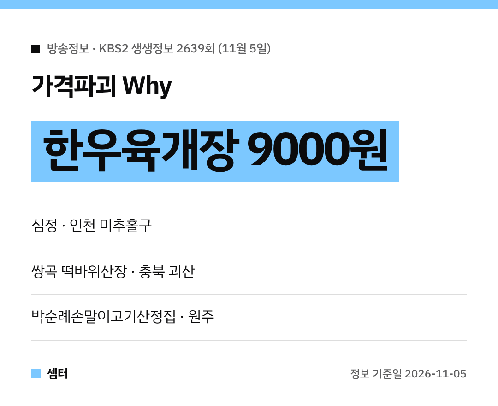

요즘 밖에서 국밥 한 그릇도 만 원 넘기 일쑤잖아요~
그런데 한우 들어간 육개장이 9000원이래요!

11월 5일 KBS2 '생생정보' 2639회에 나온 곳들 정리해 봤어요 🍲

## 가격파괴 Why: 인천 미추홀구 심정
'가격파괴 Why' 코너는 인천 미추홀구 **심정**을 찾아갔어요.
주제는 바로 한우육개장이었답니다.

**육개장은 9000원**이에요.
얼큰한 국물에 고기 듬뿍이면, 찬 바람 부는 요즘 딱이죠!

[📍 네이버 지도에서 심정 보기](https://map.naver.com/p/search/%EC%9D%B8%EC%B2%9C%20%EB%AF%B8%EC%B6%94%ED%99%80%EA%B5%AC%20%EC%8B%AC%EC%A0%95)

## 숙소를 찾아 줘: 괴산 쌍곡 떡바위산장
'숙소를 찾아 줘'는 엄마들의 가을 보양 나들이 숙소 편이었어요.
충북 괴산 쌍곡계곡 쪽 **쌍곡 떡바위산장**이 나왔어요.

계곡 따라 단풍 보면서 쉬어 가기 좋은 곳이에요~
친구들끼리 가을 여행 계획 중이라면 눈여겨보세요 😊

[📍 네이버 지도에서 쌍곡 떡바위산장 보기](https://map.naver.com/p/search/%EA%B4%B4%EC%82%B0%20%EC%8C%8D%EA%B3%A1%20%EB%96%A1%EB%B0%94%EC%9C%84%EC%82%B0%EC%9E%A5)

## 전주남부시장도 나왔어요
같은 날 방송은 전주남부시장도 소개했어요.
새벽, 낮, 밤마다 분위기가 달라지는 시장이래요.

[📍 네이버 지도에서 전주남부시장 보기](https://map.naver.com/p/search/%EC%A0%84%EC%A3%BC%EB%82%A8%EB%B6%80%EC%8B%9C%EC%9E%A5)

## 장PD의 AI 여행기: 원주 가을 여행
원주 편에서는 반계리 은행나무, 소금산 그랜드밸리, 원주 산악자전거파크, 강원감영을 돌았어요.
노랗게 물든 은행나무 보러 가기 딱 좋은 때죠~

밥은 **박순례손말이고기산정집**에서 손말이고기로 먹었어요.
얇은 소고기에 깻잎 같은 채소를 돌돌 말아 구워 먹는 메뉴예요 😋

[📍 네이버 지도에서 박순례손말이고기산정집 보기](https://map.naver.com/p/search/%EC%9B%90%EC%A3%BC%20%EB%B0%95%EC%88%9C%EB%A1%80%EC%86%90%EB%A7%90%EC%9D%B4%EA%B3%A0%EA%B8%B0%EC%82%B0%EC%A0%95%EC%A7%91)
[📍 네이버 지도에서 반계리 은행나무 보기](https://map.naver.com/p/search/%EC%9B%90%EC%A3%BC%20%EB%B0%98%EA%B3%84%EB%A6%AC%20%EC%9D%80%ED%96%89%EB%82%98%EB%AC%B4)

방송 나간 다음 날은 손님이 몰릴 수 있으니 조금 여유 있게 가 보세요!

다들 든든하게 한 끼 챙기시구! 오늘도 좋은 하루 보내세요~ㅎㅎ
