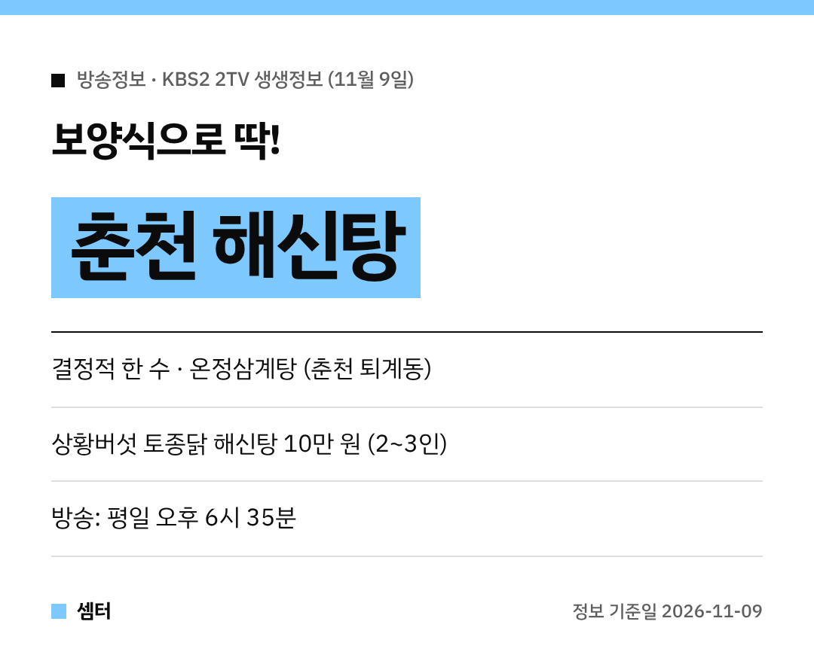

날이 확 추워지니까 뜨끈한 보양식 생각나시죠~
11월 9일 '2TV 생생정보'에 딱 맞는 메뉴가 나왔어요! 🍲

## 결정적 한 수: 춘천 온정삼계탕
'보양식으로 딱! 해신탕 & 닭볶음탕' 편 주인공은 강원 춘천의 **온정삼계탕**이에요.
상황버섯을 넣은 삼계탕, 해신탕, 닭볶음탕을 파는 보양식 전문점이랍니다.

해신탕은 닭에 전복·낙지 같은 해산물을 넣고 푹 끓인 음식이에요.
국물이 진해서 여럿이 나눠 먹기 좋아요.

## 메뉴판 가격
- 상황버섯 토종닭 해신탕 **10만 원** (2~3인, 상황찰밥 포함)
- 상황버섯 오리 해신탕 **10만 5000원** (2~3인, 상황찰밥 포함)
- 상황버섯 삼계탕 **1만 6000원**
- 상황전복삼계탕 **2만 1000원**

혼자라면 삼계탕, 가족끼리면 해신탕이 딱이겠죠?
얼큰한 걸 좋아하면 상황버섯 닭볶음탕도 있어요 😋

## 위치
춘천 **퇴계동**에 있어요.
주소는 강원 춘천시 우묵길78번길 3이에요.

[📍 네이버 지도에서 온정삼계탕 보기](https://map.naver.com/p/search/%EC%B6%98%EC%B2%9C%20%EC%98%A8%EC%A0%95%EC%82%BC%EA%B3%84%ED%83%95)

## 가기 전에
방송 다음 날은 손님이 몰릴 수 있어요.
해신탕은 2~3인용이라 인원 맞춰 가시고, 영업시간은 지도에서 한 번 확인하고 출발하세요~

다들 든든하게 몸보신하시구! 오늘도 좋은 하루 보내세요~ㅎㅎ
