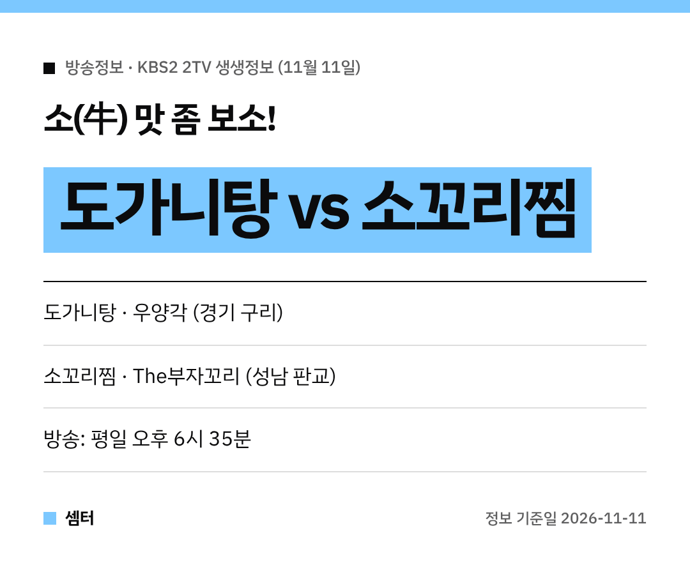

뜨끈한 국물이냐, 쫀득한 찜이냐! 고민되는 메뉴 대결이 나왔어요~
11월 11일 '2TV 생생정보' 맛집 맞수다는 **소고기 보양식** 대결이었어요 🐂

## 도가니탕: 구리 우양각
첫 번째 집은 경기 구리의 **우양각**이에요.
소 무릎 쪽 연골과 힘줄을 푹 고아 만든 **도가니탕**이 대표예요.

오래 끓인 국물에 쫀득한 식감까지, 든든한 한 끼로 딱이죠!
구리역·장자호수공원역 근처 맛집으로 꼽힌대요.

[📍 네이버 지도에서 우양각 보기](https://map.naver.com/p/search/%EA%B5%AC%EB%A6%AC%20%EC%9A%B0%EC%96%91%EA%B0%81)

## 소꼬리찜: 판교 The부자꼬리
두 번째 집은 성남 분당 판교의 **The부자꼬리**예요.
소꼬리를 부드럽게 익혀 양념에 조린 **소꼬리찜**이 주인공이에요.

뼈에 붙은 살을 발라 먹는 재미가 쏠쏠하대요 😋

[📍 네이버 지도에서 The부자꼬리 보기](https://map.naver.com/p/search/%ED%8C%90%EA%B5%90%20%EB%8D%94%EB%B6%80%EC%9E%90%EA%BC%AC%EB%A6%AC)

## 가기 전에
방송 다음 날은 손님이 몰릴 수 있어요.
영업시간과 쉬는 날은 지도에서 꼭 확인하세요~

다들 든든하게 몸보신하시구! 오늘도 좋은 하루 보내세요~ㅎㅎ
