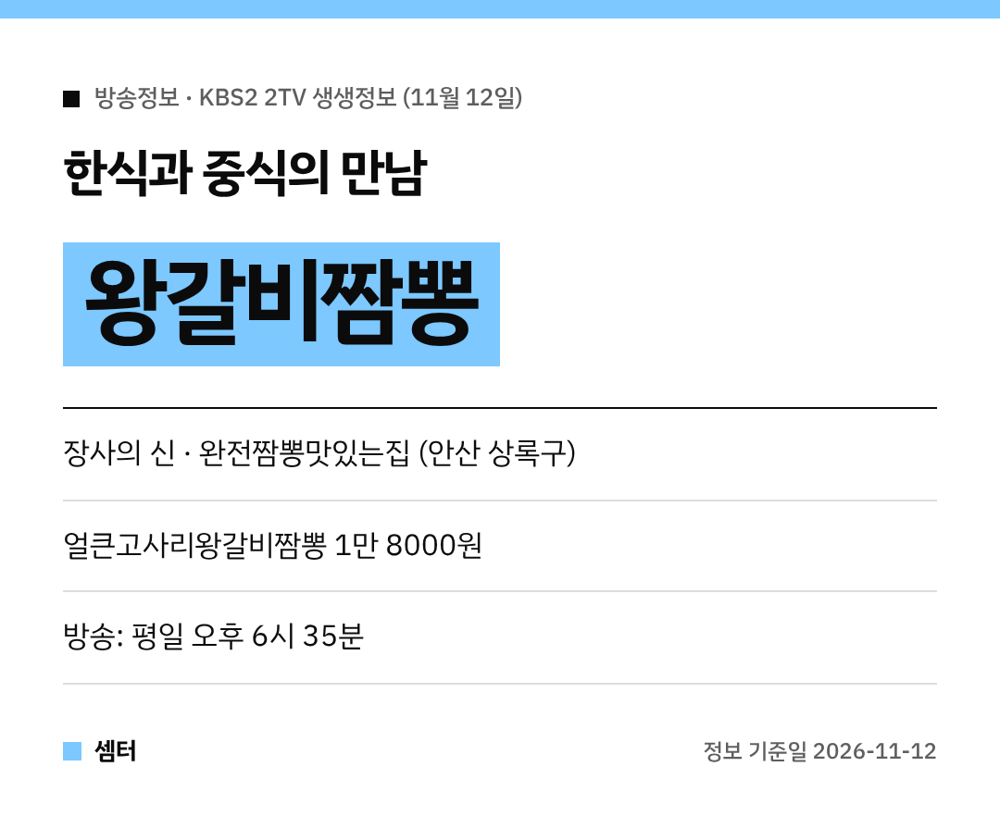

짬뽕에 왕갈비가 통째로?! 비주얼부터 남다른 메뉴가 나왔어요~
11월 12일 '2TV 생생정보' 장사의 신 코너 주인공은 **왕갈비짬뽕**이에요 🍜

## 장사의 신: 안산 완전짬뽕맛있는집
경기 안산 상록구의 **완전짬뽕맛있는집**이에요.
대표 메뉴는 **얼큰고사리왕갈비짬뽕**이랍니다.

한식에서 익숙한 왕갈비와 고사리를 중식 짬뽕에 넣은 메뉴예요.
얼큰한 국물에 갈비 풍미가 스며들어서 한 그릇이면 든든하대요!

## 가격
얼큰고사리왕갈비짬뽕은 **1만 8000원**이에요.
갈비가 큼직하게 올라가서 푸짐하대요 😋

## 위치
경기 안산시 상록구 상록수로 28이에요.

[📍 네이버 지도에서 완전짬뽕맛있는집 보기](https://map.naver.com/p/search/%EC%95%88%EC%82%B0%20%EC%99%84%EC%A0%84%EC%A7%AC%EB%BD%95%EB%A7%9B%EC%9E%88%EB%8A%94%EC%A7%91)

## 먹는 꿀팁
고기를 먼저 발라 먹고, 남은 국물에 면을 곁들이면 좋대요.
방송 다음 날은 손님이 몰릴 수 있으니 영업시간은 지도에서 확인하고 가세요~

다들 든든하게 한 그릇 하시구! 오늘도 좋은 하루 보내세요~ㅎㅎ
