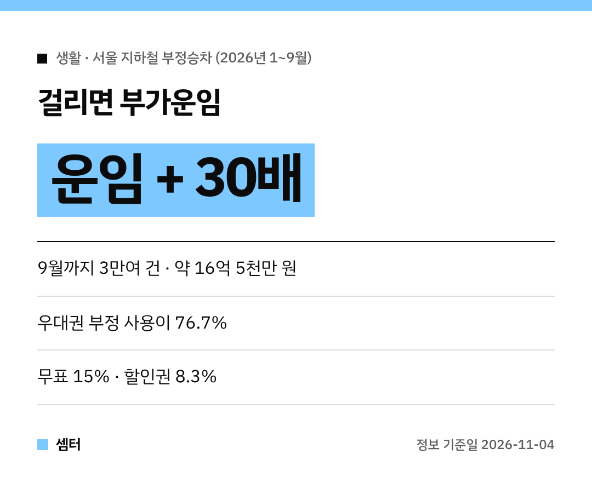

"엄마 카드 잠깐 빌려 탔는데 괜찮겠지~" 했다가 큰코다칠 수 있어요 😅
서울 지하철 부정승차 단속 결과가 나왔는데, 생각보다 훨씬 많았대요.

## 얼마나 걸렸어요?
서울교통공사가 올해 1~9월 적발한 부정승차는 **3만 건이 넘어요**.
이렇게 받아 낸 돈만 **약 16억 5천만 원**이래요.

2023~2025년 3년 동안은 약 16만 건, 한 해 평균 5만 3천 건꼴이었고요.

## 제일 많은 건 '우대권 빌려 타기'
| 유형 | 비율(단속액) |
|---|---|
| 노인·장애인 **우대권** 부정 사용 | **76.7%** |
| 표 없이 타고 신고 안 함 | 15% |
| 청소년 할인권 등 부정 사용 | 8.3% |

부모님 경로카드나 가족 장애인 카드를 대신 쓰는 경우가 대부분이었대요.
본인만 쓸 수 있는 카드라는 거, 꼭 기억해 주세요!

## 걸리면 얼마나 내요?
철도사업법과 공사 약관에 따라 **탄 구간 운임 + 그 운임의 30배**를 부가운임으로 내야 해요.
몇 번 걸리면 금방 수십만 원이 되는 셈이에요 😱

## 요즘 집중 단속 중이에요
서울교통공사가 코레일, 공항철도, 신분당선, 9호선 같은 수도권 운영기관과 함께 **부정승차 예방 캠페인**을 하고 있어요.
환승역에서 단속도 같이 한대요.

자녀 청소년 할인 카드도 나이가 지나면 바꿔 주시고, 카드는 본인 것만 찍어 주세요~

다들 기분 좋게 출퇴근하시구! 오늘도 좋은 하루 보내세요~ㅎㅎ
