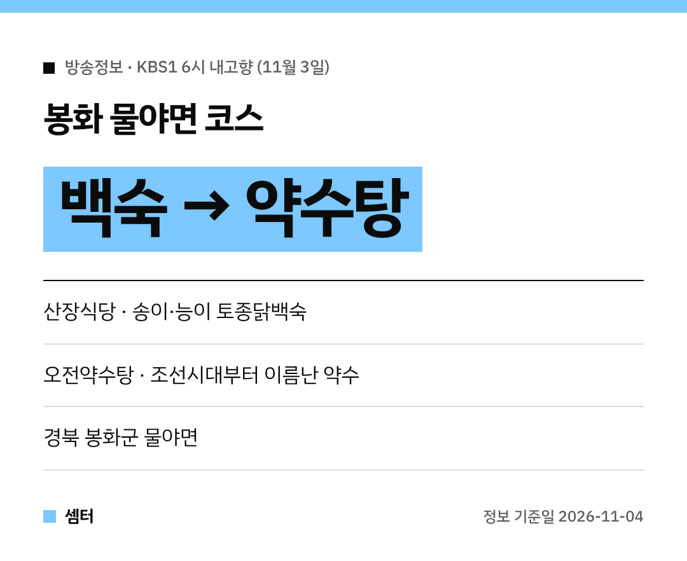

쌀쌀해지면 생각나는 보양식, 백숙이죠~!
11월 3일 KBS1 '6시 내고향'에서 경북 봉화 물야면 백숙집이 나왔어요 🍲

## 봉화 물야면 산장식당
물야면 오전리에 있는 백숙 전문점 **산장식당**이에요.
대표 메뉴는 **자연산 송이 토종닭백숙**과 **자연산 능이 토종닭백숙**이래요!

토종옻닭백숙, 한방토종닭백숙, 닭불고기, 감자전 같은 메뉴도 있어요.

[📍 네이버 지도에서 산장식당 보기](https://map.naver.com/p/search/%EB%B4%89%ED%99%94%20%EB%AC%BC%EC%95%BC%EB%A9%B4%20%EC%82%B0%EC%9E%A5%EC%8B%9D%EB%8B%B9)

## 백숙 먹고 오전약수탕
백숙으로 든든하게 채운 뒤 들른 곳은 **오전약수탕**이에요.
조선시대부터 좋은 약수로 이름났던 곳이래요 😊

[📍 네이버 지도에서 오전약수탕 보기](https://map.naver.com/p/search/%EB%B4%89%ED%99%94%20%EC%98%A4%EC%A0%84%EC%95%BD%EC%88%98%ED%83%95)

단풍철 드라이브 코스로 묶어 가기 좋겠어요.
송이·능이는 제철 재료라 가기 전에 메뉴가 되는지 전화로 먼저 물어보세요!

다들 든든하게 몸보신하시구! 오늘도 좋은 하루 보내세요~ㅎㅎ
